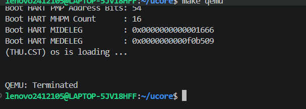

# 操作系统实验报告：Lab 3 中断与异常处理

## 实验基本信息

| 项目 | 内容 |
|------|------|
| **实验名称** | Lab 3: 中断与异常处理 |
| **小组成员** | 2412896-石欣哲、2412105-贺佳怡、2412634-罗茜 |
| **完成日期** | 2026-11-03 |

### 小组分工

| 成员 | 负责的练习/模块 |
|------|----------------|
| 2412896-石欣哲 | 功能模块一：`RESTORE_ALL`、`__alltraps` 调用 `trap()`；整体 Trap 执行流；系统集成与最终验收 |
| 2412105-贺佳怡 | 功能模块二：`interrupt_handler()`（时钟中断、中断分类、关机条件） |
| 2412634-罗茜 | 功能模块二：`exception_handler()`（非法指令、断点异常、`epc` 更新、兜底） |

**报告分工：** 本文件为石欣哲个人负责章节；功能模块二的具体实现、prompt 与 bug 记录由贺佳怡、罗茜分别在各自章节中说明，本文件只从 Trap 入口与集成视角说明接口衔接。

---

## 一、实验目的

本实验在 Lab 2 物理内存管理与 Sv39 页表的基础上，为最小可执行内核加入 Trap 处理能力，主要目的包括：

1. 理解 RISC-V 中 **Trap = 中断（Interrupt）+ 异常（Exception）** 的统一概念，以及 S 模式下的 `stvec`、`sepc`、`scause`、`stval`、`sstatus` 等 CSR 的作用。
2. 掌握 Trap 发生时的 **上下文保存与恢复**：`SAVE_ALL` 如何把 32 个通用寄存器和 4 个 CSR 组织成 `struct trapframe`，`RESTORE_ALL` 如何按同一布局恢复。
3. 掌握 **汇编入口与 C 语言处理函数之间的调用约定**：`__alltraps` 如何通过 `a0` 把 `TrapFrame *` 传给 `trap()`，以及 `trap()` 返回后如何经 `__trapret`、`sret` 回到原执行流。
4. 通过时钟中断、非法指令异常、断点异常验证 Trap 机制的完整闭环。
5. 实践“设计 prompt 让 AI 生成代码 + 人工核验 + 迭代修正”的 AI 协作开发流程。

---

## 二、实验环境

| 成员 | AI 编程工具 | 底层模型 | 备注 |
|------|------------|---------|------|
| 2412896-石欣哲 | VS Code + Cline / Copilot 对话式辅助 | 对话式大模型（按实际填写） | WSL2 Ubuntu 24.04、GCC 13.2.0、QEMU 4.1.1 |
| 2412105-贺佳怡 | 按个人章节填写 | 按个人章节填写 | Windows + WSL2、QEMU 8.2.2 |
| 2412634-罗茜 | 按个人章节填写 | 按个人章节填写 | Intel Mac + Docker Ubuntu 22.04.5、QEMU 4.1.1 |

**说明：** 本实验代码通过 Git 分支管理：`lab3` 为共享基线，`feat/trapentry-sxz`、`feat/interrupt-hjy`、`feat/exception-lqx` 为三人功能分支，最终由石欣哲合并。

---

## 三、实验整体逻辑分析

### 3.1 本章节的逻辑主线

Lab 3 的核心问题是：**内核如何从“能运行”变成“能被外部事件和异常打断，并且打断后还能正确回来”**。围绕这个问题，实验按三条主线展开：

1. **Trap 上下文保存与恢复**：Trap 发生时，硬件只自动保存 `sepc`、`scause`、`stval` 并切换特权级，通用寄存器不会自动保存。因此软件必须先用 `SAVE_ALL` 把现场组织成 `struct trapframe`，返回前再用 `RESTORE_ALL` 恢复。
2. **Trap 入口与返回**：`stvec` 指向统一入口 `__alltraps`，入口负责保存现场、按 RISC-V 调用约定把 `TrapFrame *` 传给 C 函数 `trap()`；`trap()` 返回后经 `__trapret` 执行 `RESTORE_ALL`，最后用 `sret` 完成特权级返回。
3. **中断与异常处理**：`trap_dispatch()` 根据 `scause` 最高位区分中断和异常，分别交给 `interrupt_handler()` 和 `exception_handler()`；时钟中断验证“持续触发 + 重新设置下一次事件”，非法指令和断点异常验证“`epc` 正确推进、不重复执行异常指令”。

这三条主线的关系是：**第 1、2 条是底座，第 3 条是业务**。没有正确的上下文保存/恢复和入口调用约定，后面的 handler 即使逻辑正确也无法安全返回；反过来，只有底座没有 handler，Trap 虽然能进出，但不会产生可观察的行为。

### 3.2 功能的逐步实现

1. **先补 Lab 2 基线**：Lab 3 依赖 Lab 2 的 `page_init()` 和 `best_fit_pmm.c`，但 `lab3_new` 中这两处只保留了 `//lab2 请补充你在lab2中的代码` 占位。因此第一步是把 Lab 2 已完成实现填回占位，保证 `make` 通过。
2. **再拆分 `trap.c` 函数边界**：`trap.c` 原本只有一个共享的 `//lab3 function2 YOUR CODE` 空位。为了让三人并行开发不冲突，先把空位机械拆成 `interrupt_handler()` 和 `exception_handler()` 两个空函数壳，只建立边界，不写逻辑。
3. **实现 `RESTORE_ALL`**：它必须与已有 `SAVE_ALL` 的 36 个槽位严格对应，尤其是 `x2(sp)` 不能按普通寄存器恢复。
4. **实现 `__alltraps` 调用 `trap()`**：把当前 `sp`（即 TrapFrame 起始地址）放入 `a0`，再 `jal trap`。
5. **实现 `interrupt_handler()` / `exception_handler()`**：分别由贺佳怡、罗茜完成，负责时钟中断持续触发、非法指令与断点异常的 `epc` 更新和兜底输出。
6. **集成与验收**：合并三个功能分支，跑 `make grade`，验证 Test 1/2/3。

---

## 四、实验内容与实现

### 功能模块一：Trap 上下文恢复与 Trap 入口

**负责人：** 2412896-石欣哲

#### 模块功能描述

**需要实现/修改的汇编功能：**

```asm
.macro RESTORE_ALL
    ...
.endm

__alltraps:
    SAVE_ALL
    ...
```

**功能说明：**

本模块是 Trap 机制的底层底座，负责两件事：

1. `RESTORE_ALL`：从当前栈上的 `TrapFrame` 恢复 32 个通用寄存器和 `sstatus/sepc/stval/scause`，使处理器状态回到 Trap 发生前。
2. `__alltraps`：在 `SAVE_ALL` 之后，把 `TrapFrame` 地址按 RISC-V 调用约定作为第一个参数传给 `trap(struct trapframe *tf)`，使 C 语言层能够处理 Trap；`trap()` 返回后落入 `__trapret`，执行 `RESTORE_ALL` 和 `sret`。

它与其他模块的交互是：向上承接硬件通过 `stvec` 跳入的统一入口；向下为 `trap()`、`trap_dispatch()`、`interrupt_handler()`、`exception_handler()` 提供正确的 `TrapFrame`；返回路径依赖 `sret` 和 `sstatus.SPP/SPIE` 完成特权级恢复。

#### 关键设计分析

**（1）为什么 `RESTORE_ALL` 必须与 `SAVE_ALL` 严格对应**

`SAVE_ALL` 把 36 个槽位按 `struct trapframe` 的内存布局写到栈上：

- 偏移 `0..31*REGBYTES`：`x0..x31`；
- 偏移 `2*REGBYTES`：原始 `sp`（由 `csrrw s0, sscratch, x0` 取出）；
- 偏移 `32/33/34/35*REGBYTES`：`sstatus/sepc/stval/scause`。

`RESTORE_ALL` 不能“自己假设一个布局”，否则恢复出来的寄存器和 CSR 会与 `trap()` 看到的 `TrapFrame` 不一致，表现为返回后程序跑飞或反复 Trap。

**（2）为什么 `sp` 必须最后恢复**

`RESTORE_ALL` 中所有 `LOAD` 都以 `sp` 为基址：

```asm
LOAD x1, 1*REGBYTES(sp)
...
LOAD sp, 2*REGBYTES(sp)
```

如果先恢复 `sp`，后面的 `LOAD` 就会以“Trap 发生前的栈指针”为基址，而不是以 `TrapFrame` 起始地址为基址，偏移全部错位。因此 `sp` 必须放在最后一条恢复，且它恢复后不再有任何依赖 `sp` 的 `LOAD`。这是本模块最容易出错的设计点，也是指导书特别强调“`x2(sp)` 处理方式与其他寄存器不同”的原因。

**（3）为什么用 `t0` 作为 CSR 恢复的临时寄存器**

RISC-V 不能直接把内存值写入 CSR，必须“先 `LOAD` 到通用寄存器，再 `csrw`”。选择 `t0` 的理由是：

- `t0` 是 caller-saved 临时寄存器，不属于函数参数/返回值；
- `t0` 在 `SAVE_ALL` 中已被保存到 `40(sp)`，后面恢复通用寄存器时会从 `40(sp)` 重新加载，因此前面用 `t0` 读 CSR 不会污染最终恢复结果；
- 不使用 `a0`，避免影响后续可能的参数传递语义。

**（4）为什么 `__alltraps` 用 `mv a0, sp` + `jal trap`**

RISC-V 调用约定规定第一个整型参数放在 `a0`。`SAVE_ALL` 执行后，`sp` 正好指向 `TrapFrame` 起始地址，因此：

```asm
mv a0, sp
jal trap
```

就把 `TrapFrame *` 正确传给了 `trap()`。使用 `jal` 而不是 `call`，是因为 `jal` 直接写 `ra` 并跳转，语义清晰；`ra` 的原值已由 `SAVE_ALL` 保存在 `1*REGBYTES(sp)`，`RESTORE_ALL` 会恢复它，所以不会破坏返回地址。`trap()` 返回后自然落入 `__trapret`，不需要额外跳转。

**（5）`sret` 的返回语义**

`__trapret` 最后执行 `sret`。`sret` 的行为是：

- `pc ← sepc`；
- 根据 `sstatus.SPP` 决定返回 U 模式还是 S 模式；
- `sstatus.SIE ← sstatus.SPIE`，`sstatus.SPIE ← 1`，`sstatus.SPP ← 0`。

这也是 `RESTORE_ALL` 必须先恢复 `sstatus` 和 `sepc` 的原因：`sret` 依赖这两个 CSR 的当前值完成返回。会议纪要中提到 x86 的 `IRET` 需要根据栈中信息动态判断弹出 3 个还是 5 个栈元素，而 RISC-V 用 `sret/uret/mret` 区分特权级返回，避免了 `IRET` 那种“栈被破坏即产生安全漏洞”的设计缺陷。本实验全程在 S 模式，使用 `sret`。

#### 最终提示词

```text
【任务说明】
在当前 Lab3 工程的 kern/trap/trapentry.S 中，实现 Trap 上下文恢复宏 RESTORE_ALL，
并在 __alltraps 中建立汇编入口与 C 语言 trap(struct trapframe *tf) 之间的调用关系。
目标：Trap 发生时 SAVE_ALL 已把 36 个槽位保存到内核栈上的 TrapFrame；
RESTORE_ALL 从同一 TrapFrame 恢复处理器状态；__alltraps 把 TrapFrame
地址按 RISC-V 调用约定传给 trap()，trap() 返回后进入 __trapret 执行 RESTORE_ALL 和 sret。

约束：
- 不得修改 SAVE_ALL 的寄存器保存顺序和 TrapFrame 布局；
- 不得修改 struct trapframe、trap() 的函数签名；
- 不得修改 trap.c 中已有的 print_trapframe / print_regs / trap_dispatch；
- 只允许修改 trapentry.S 中 RESTORE_ALL 宏体和 __alltraps 中调用 trap() 的位置；
- 保留所有 lab3 注释，把 YOUR CODE 替换为本人学号。

【依赖说明】
- trapentry.S 已 #include <riscv.h>；
- SAVE_ALL 已保存 x0..x31 到偏移 0..31*REGBYTES，
  x2(sp) 的原始值保存在偏移 2*REGBYTES，
  sstatus/sepc/stval/scause 分别保存在 32/33/34/35*REGBYTES；
- riscv.h 定义了 STORE/LOAD/REGBYTES 和 CSR_SBADADDR；
- trap() 的 C 语言签名是 void trap(struct trapframe *tf)；
- __trapret 已存在，内部执行 RESTORE_ALL 和 sret。

【接口清单】
- 保持 RESTORE_ALL 宏名不变；
- 保持 __alltraps 符号名和 .align(2) 不变；
- 保持 __trapret 路径不变；
- 允许 RESTORE_ALL 内部使用 t0 作为临时寄存器读取 CSR；
- 允许 __alltraps 中使用 a0 传递 TrapFrame 地址。

【行为规格】
RESTORE_ALL：
- 前置：sp 指向当前 TrapFrame 起始地址；
- 后置：sstatus/sepc/stval/scause 被恢复到 TrapFrame 中保存的值；
- 后置：x1、x3..x31 从对应偏移恢复；
- 后置：x2(sp) 最后从偏移 2*REGBYTES 恢复，恢复后 sp 回到 Trap 发生前的值；
- 不得先恢复 sp 再恢复其它寄存器，否则后续偏移会错。

__alltraps：
- 前置：SAVE_ALL 已执行，sp 指向 TrapFrame；
- 后置：a0 = 当前 sp，即 TrapFrame 地址；
- 后置：调用 trap()，调用前后 sp 保持一致；
- 后置：trap() 返回后落入 __trapret。

验证：
- make clean && make 通过；
- objdump -d 检查 RESTORE_ALL 的偏移与 SAVE_ALL 对应；
- __alltraps 中 a0 在 jal trap 前被设置为 sp。
```

#### 实现迭代过程

本模块的实现经历了 4 次迭代。

---

##### 第一次迭代：补齐 Lab 2 基线

**遇到的问题：**

- `lab3/kern/mm/best_fit_pmm.c` 只有测试函数，报错 `'free_list' undeclared`、`'nr_free' undeclared`，缺少 `best_fit_init`、`best_fit_alloc_pages` 等实现；
- `lab3/kern/mm/pmm.c` 报错 `implicit declaration of function 'page_init'`，缺少 `page_init()` 定义。

**问题解决策略：**

- 两处文件都保留了 `//lab2 请补充你在lab2中的代码` 占位，说明 Lab 3 预期把 Lab 2 已完成实现填回占位；
- 从 `origin/lab2:code/kern/mm/best_fit_pmm.c` 原样补齐实现段和 `best_fit_pmm_manager`，保留 Lab 2 原作者注释，不标成本人学号；
- 从本人 Lab 2 的 `pmm.c` 补回 `page_init()`，保留 `//lab2 function1 2412896` 注释；
- 不在 Lab 3 基线阶段额外加 `buddy_pmm.h`、`slub.h`、`slub_check()`，避免引入 Lab 2 扩展模块的依赖。

**结果：** `make clean && make` 通过。

---

##### 第二次迭代：`RESTORE_ALL` 的 CSR 兼容性问题

**遇到的问题：**

第一次写 `RESTORE_ALL` 时，CSR 恢复部分沿用指导书中的：

```asm
csrw sbadaddr, t0
```

汇编报错：

```text
Error: unknown CSR `sbadaddr'
```

原因：`sbadaddr` 是旧版 RISC-V 的 CSR 名称，当前工具链只认标准名 `stval`；但项目 `riscv.h` 中已经定义了 `CSR_SBADADDR 0x143`。

**问题解决策略：**

- 不依赖汇编器认哪个 CSR 名称，改用 `riscv.h` 中已有的宏：

```asm
csrw CSR_SBADADDR, t0
```

- 预处理后变成 `csrw 0x143, t0`，汇编器不会再报未知 CSR；
- `SAVE_ALL` 中对应的 `csrr s3, CSR_SBADADDR` 也做同样处理，保证保存/恢复对称。

**结果：** `trapentry.S` 汇编通过。

---

##### 第三次迭代：`RESTORE_ALL` 的恢复顺序

**遇到的问题：**

最初容易把所有寄存器按偏移顺序恢复，包括把 `sp` 放在 `x31` 之后、但仍可能在其它 `LOAD` 之前。这样后续 `LOAD` 会以错误基址访问。

**问题解决策略：**

- 把 CSR 恢复放在最前面，用 `t0` 读 `sstatus/sepc/stval/scause`；
- 再恢复 `x1`、`x3..x31`；
- 最后单独恢复 `x2(sp)`：

```asm
LOAD sp, 2*REGBYTES(sp)
```

- 明确 `sp` 恢复后不再执行任何依赖 `sp` 的 `LOAD`。

**结果：** `objdump -d` 确认偏移与 `SAVE_ALL` 对应：

```text
sstatus = 256(sp) = 32*8
sepc    = 264(sp) = 33*8
stval   = 272(sp) = 34*8
scause  = 280(sp) = 35*8
sp      = 16(sp)  = 2*8
```

---

##### 第四次迭代：`__alltraps` 调用 `trap()`

**遇到的问题：**

`__alltraps` 中 `SAVE_ALL` 之后原本只有 `#lab3 function1 YOUR CODE` 和 `# sp should be the same as before "jal trap"`，没有建立与 `trap()` 的调用关系。

**问题解决策略：**

- 按 RISC-V 调用约定，把 `TrapFrame *` 放到 `a0`：

```asm
mv a0, sp
jal trap
```

- 不额外调整 `sp`，保证 `jal trap` 前后 `sp` 一致；
- `trap()` 返回后自然落入 `__trapret`，执行 `RESTORE_ALL` 和 `sret`。

**结果：**

- `make clean && make` 通过；
- `objdump -d` 确认 `__alltraps` 中在 `jal trap` 前有 `mv a0, sp`；
- QEMU 运行 10 秒，内核启动到 `++ setup timer interrupts`，未崩溃、未反复 panic。由于 `interrupt_handler()` 此时仍为空函数壳，暂不打印 `100 ticks`，这属于预期状态。

**关键改进点总结：**

1. 在依赖说明中明确 `SAVE_ALL` 的 36 槽位布局和 `x2(sp)` 特殊偏移，避免 AI 自行假设布局；
2. 在行为规格中明确“`sp` 最后恢复，且恢复后不再有依赖 `sp` 的 `LOAD`”；
3. 在接口清单中允许使用 `a0` 传参、`t0` 读 CSR，同时禁止修改 `SAVE_ALL`、`struct trapframe` 和 `trap()` 签名；
4. 针对工具链兼容性，把 CSR 引用方式从裸名改为 `riscv.h` 已有宏，避免不同汇编器对旧 CSR 名支持不一致。

---

### 功能模块二：中断与异常处理（接口与集成视角）

**负责人：** 2412105-贺佳怡（`interrupt_handler`）、2412634-罗茜（`exception_handler`）

本模块的完整实现、prompt 与 bug 记录见两位负责人各自章节。这里只从 Trap 入口负责人和集成人视角说明接口衔接：

- `trap_dispatch()` 根据 `tf->cause` 最高位区分中断/异常：最高位为 1 调用 `interrupt_handler()`，否则调用 `exception_handler()`；
- `interrupt_handler()` 对 `IRQ_S_TIMER` 必须调用 `clock_set_next_event()` 并累加 `ticks`，否则系统只会收到一次时钟中断；达到 `TICK_NUM` 整数倍输出统计，达到关机条件调用 `sbi_shutdown()`；
- `exception_handler()` 对 `CAUSE_ILLEGAL_INSTRUCTION` 和 `CAUSE_BREAKPOINT` 必须正确更新 `tf->epc`，不能固定假设 4 字节；否则 `sret` 返回后会再次执行同一条异常指令，形成异常循环；
- 两个 handler 都不得修改 `trap()`、`trap_dispatch()` 的函数签名，处理后必须返回统一的 `__trapret` 路径。

从集成角度看，本模块与功能模块一的接口契约是：**功能模块一保证 `trap(tf)` 收到完整、布局正确的 `TrapFrame`，并保证 `trap()` 返回后能恢复到 Trap 发生前的执行流；功能模块二只负责在 `trap()` 内部根据 `tf->cause` 修改 `tf` 中允许修改的字段（主要是 `tf->epc`）并完成设备/计数/关机等副作用。**

---

## 五、测试与验证

### 5.1 编译与静态检查

```bash
cd ~/OS-104/lab3
make clean && make
```

结果：编译通过，生成 `bin/kernel` 和 `bin/ucore.img`。

### 5.2 `objdump` 检查 `RESTORE_ALL`

```bash
riscv64-unknown-elf-objdump -d bin/kernel | awk '/<__trapret>:/,/sret/'
```

关键输出：

```text
ld t0,256(sp)   ; sstatus = 32*8
csrw sstatus,t0
ld t0,264(sp)   ; sepc = 33*8
csrw sepc,t0
ld t0,272(sp)   ; stval = 34*8
csrw stval,t0
ld t0,280(sp)   ; scause = 35*8
csrw scause,t0
...
ld sp,16(sp)    ; 原始 sp = 2*8，最后恢复
sret
```

### 5.3 `objdump` 检查 `__alltraps`

```bash
riscv64-unknown-elf-objdump -d bin/kernel | awk '/<__alltraps>:/,/^$/'
```

确认 `SAVE_ALL` 之后有：

```text
mv a0, sp
jal trap
```

即 `TrapFrame *` 通过 `a0` 传给 `trap()`。

### 5.4 QEMU 运行

```bash
timeout 10s make qemu
```

观察到内核依次输出：

```text
OpenSBI v0.4 ...
DTB Init
...
(THU.CST) os is loading ...
...
check_alloc_page() succeeded!
satp virtual address: ...
++ setup timer interrupts
```

10 秒内未出现 panic、未反复打印 trapframe。由于 `interrupt_handler()` 仍为空函数壳，暂不打印 `100 ticks`，这是当前阶段的预期状态，真正的时钟中断闭环要等功能模块二合并后验证。

### 5.5 待集成验证项

- `make grade` 的 Test 1：依赖 `exception_handler()` 的 `ebreak` 分支，需在集成分支上执行；
- Test 3：依赖 `interrupt_handler()` 的时钟中断持续触发，需在集成分支上执行；
- 最终 `Total Score: 100/100` 需三人分支合并后统一验收。



---

## 六、实验总结与收获

### 对操作系统的理解

**1. 本实验重要知识点与 OS 原理的对应**

| 本实验知识点 | 对应 OS 原理 | 关系与差异 |
|---|---|---|
| RISC-V Trap = 中断 + 异常 | 中断/异常/系统调用统称“陷阱” | RISC-V 用 `scause` 最高位区分中断/异常；传统 OS 常把 Trap 狭义指主动异常，本实验需注意术语差异 |
| `stvec` 统一入口 `__alltraps` | 中断向量表 / IDT | 本实验用 Direct 模式，所有 Trap 跳同一入口；x86 用 IDT 按中断号寻址，但常统一指向 `alltraps` 再分拣，设计思想一致 |
| `SAVE_ALL` / `RESTORE_ALL` | 上下文切换 | 本实验只保存通用寄存器和 4 个 CSR，不含浮点/向量寄存器；真实 OS 的上下文切换还要处理地址空间、FPU 状态等 |
| `sret` | 中断返回 / 特权级返回 | RISC-V 用 `sret/uret/mret` 区分返回特权级；x86 `IRET` 依赖栈中信息动态判断，历史上易因栈破坏产生安全漏洞 |
| `sstatus.SIE/SPIE/SPP` | 中断屏蔽与特权级保存 | 进入 Trap 时硬件把 `SIE` 存入 `SPIE` 并清零 `SIE`，`sret` 时恢复；这保证 Trap 处理期间不被同类中断打断 |
| `local_intr_save/restore` | 临界区 / 原子操作 | 本实验在 `alloc_pages/free_pages` 中用关中断保护空闲链表；真实 OS 会用自旋锁、信号量等更细粒度机制 |
| 时钟中断 + `ticks` | 时间片 / 调度器 tick | 本实验只计数和打印；真实 OS 在 tick 中触发调度、更新进程时间片、处理定时器 |

**2. 本实验的“简化设定”**

- 全程在 S 模式运行，没有真正的 U→S 切换，因此 `sscratch` 保存内核栈的机制没有完整使用；
- 不支持内核态中断嵌套；
- 不处理缺页异常；
- 时钟中断只计数，不做进程调度；
- `ecall` 没有实现具体系统调用服务。

这些简化让实验聚焦在 Trap 的“保存—进入 C—恢复—返回”闭环上，但也意味着它距离完整 OS 的中断子系统还有明显距离。

**3. OS 原理中很重要、但本实验未覆盖的知识点**

- 用户态进程与真正的 U→S 系统调用路径；
- 中断嵌套与中断优先级；
- 缺页异常与按需分页；
- 多核中断路由与 IPI；
- 时钟中断驱动的进程调度与时间片轮转；
- 中断下半部 / 软中断 / 工作队列等延迟处理机制。

### AI 协作开发的经验

1. **prompt 的“依赖说明”比“任务说明”更容易被忽略，但往往决定成败。** 本模块第一次出错就是因为没有在依赖里写清 `SAVE_ALL` 的 36 槽位布局和 `x2(sp)` 特殊偏移，AI 容易按“普通寄存器顺序”恢复。把布局和约束写进依赖后，生成结果才稳定。
2. **“不可修改”的边界要写死。** `SAVE_ALL`、`struct trapframe`、`trap()` 签名这三样一旦被 AI 改动，后面所有模块都会连锁出错，所以 prompt 里必须明确禁止。
3. **工具链兼容性要作为独立约束写进 prompt。** `sbadaddr` 这种旧 CSR 名在不同工具链下表现不同，最稳的做法是要求 AI 使用项目已有宏（如 `CSR_SBADADDR`），而不是裸 CSR 名。
4. **AI 生成的汇编必须用 `objdump` 人工核验。** 编译通过不等于布局正确；偏移、恢复顺序、`a0` 传参这些必须看反汇编确认。
5. **小任务及时 commit。** 本模块拆成“基线补齐”“`RESTORE_ALL`”“`__alltraps`”“报告记录”多个提交，出问题时可以精确回滚，也方便集成时定位。