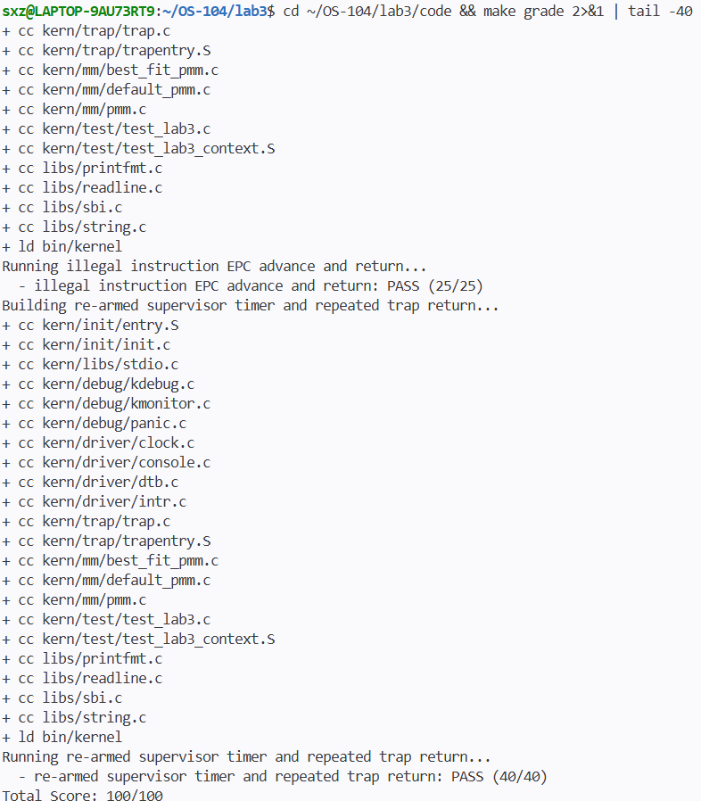

# 操作系统实验报告

## 实验基本信息

| 项目 | 内容 |
|------|------|
| **实验名称** | Lab 3：中断与异常处理 |
| **小组成员** | 2412896-石欣哲、2412105-贺佳怡、2412634-罗茜 |
| **完成日期** | 2026-11-03 |

### 小组分工

练习分工

| 成员 | 负责的练习/模块 |
|------|----------------|
| 2412896-石欣哲 | Trap 上下文恢复、Trap 入口与集成 |
| 2412105-贺佳怡 | 中断分类、时钟中断处理 |
| 2412634-罗茜 | 非法指令、断点及其他异常处理 |

实验报告分工

Lab3 实验报告按成员负责模块拆分撰写，最后由石欣哲汇总与格式检查：

| 成员 | 报告撰写范围 |
|---|---|
| 2412896-石欣哲 | 整体 Trap 执行流、TrapFrame 布局、上下文保存与恢复、`RESTORE_ALL` 与 `__alltraps` 的汇编调用约定；本模块 spec、prompt、AI 生成 bug 及解决过程；负责报告汇总、格式检查、注释与学号检查、最终集成与推送。 |
| 2412105-贺佳怡 | 中断分类、时钟中断、OpenSBI 定时器、`sstatus/sie` 与中断重新设置；`interrupt_handler()` 模块 spec、prompt、AI 生成 bug 及解决过程。 |
| 2412634-罗茜 | 异常分类、非法指令与断点处理、RISC-V 指令长度判断、`tf->epc` 更新、未知异常兜底；相关 OS 原理知识点映射、本实验未覆盖知识点；`exception_handler()` 模块 spec、prompt、AI 生成 bug 及解决过程。 |

报告文件位于 `lab3/report/report.md`，AI 提示词汇总位于 `lab3/report/prompt.md`。各成员只负责本人模块内容，石欣哲负责最终汇总与格式统一，不改写其他成员已提交的模块内容。。

---

## 一、实验目的

本实验的主要目的是：

1. 理解 RISC-V Trap 机制及用户态、内核态切换。
2. 掌握中断和异常发生时的上下文保存、处理与恢复流程。
3. 实现断点、非法指令和时钟中断，并学习使用 AI 辅助开发操作系统功能。

---

## 二、实验环境

| 成员 | 宿主系统 | 交叉编译器 | 模拟器 | 编辑器 |
|---|---|---|---|---|
| 2412896-石欣哲 | WSL Ubuntu 24.04 | riscv64-unknown-elf-gcc 13.2.0 | QEMU 4.1.1 | VS Code + WSL |
| 2412105-贺佳怡 | Windows + WSL2 Ubuntu | riscv64-unknown-elf-gcc 13.2.0 | QEMU 4.1.1 | VS Code + WSL |
| 2412634-罗茜 | Intel Mac + Docker Ubuntu 22.04.5 | riscv64-unknown-elf-gcc 10.2.0 | QEMU 4.1.1 | VS Code + Docker |

**AI 工具**

| 成员 | AI 编程工具 | 底层模型 |
|---|---|---|
| 2412896-石欣哲 | Cline（VS Code 插件） | DeepSeek-v4-flash |
| 2412105-贺佳怡 | Claude Code（VS Code 插件） | DeepSeek-V4-Pro |
| 2412634-罗茜 | Claude Code | DeepSeek-V4-Pro |

---

## 三、实验整体逻辑分析

### 2.1 本章节的逻辑主线
Lab3 其实就是围绕“硬件接管 -> 现场保存 -> 软件分发 -> 现场恢复”这套流程转的。

当系统发生中断或异常时，CPU 硬件会自动跳到 stvec 寄存器指向的入口（也就是石欣哲负责写的 __alltraps 汇编部分）。接着，汇编代码把各种寄存器的值压栈，拼装成一个 struct trapframe 结构体，这就相当于把案发现场保护起来了。然后程序进入 C 语言环境，执行 trap()，在这个函数里，会根据 cause 寄存器的最高位判断它是中断还是异常，再分发给对应的 handler 去处理。石欣哲负责的 interrupt_handler 就是在这时被调用的。处理完毕后，最后通过汇编恢复寄存器，执行 sret，让 CPU 回到刚才被打断的地方继续跑。

### 2.2 功能的逐步实现

1.首先实现 Trap 入口与上下文保存/恢复。硬件在 Trap 发生时跳转到 stvec 指向的 __alltraps；SAVE_ALL 把 32 个通用寄存器和 4 个 CSR 保存成 struct trapframe。
2. 接着实现 __alltraps 到 C 语言 trap() 的调用关系：把当前 sp（TrapFrame 地址）通过 a0 传入，执行 jal trap，使汇编入口与 C 处理函数衔接。
3.然后实现中断与异常分发处理：trap_dispatch() 根据 tf->cause 最高位区分中断和异常，分别进入 interrupt_handler() 和 exception_handler()。
4.最后实现 RESTORE_ALL 与 sret 返回闭环：从 TrapFrame 恢复 CSR 和通用寄存器，最后恢复原始 sp，执行 sret 回到被打断的执行流。

---

## 四、实验内容与实现

### 功能模块一：Trap 上下文恢复与入口

**负责人：** 2412896-石欣哲

#### 模块功能描述

**需要实现/修改的函数：**

```asm
# RESTORE_ALL
# __alltraps
```

**功能说明：**

本模块负责 Trap 从“进入内核”到“返回原执行流”之间的底层上下文管理。SAVE_ALL 已把 Trap 发生时的处理器状态保存到内核栈上的 TrapFrame，共 36 个槽位：x0~x31 通用寄存器，以及 sstatus、sepc、sbadaddr/stval、scause 四个 CSR。

RESTORE_ALL 必须与 SAVE_ALL 的布局严格对应：先恢复 sstatus、sepc、stval、scause，再恢复 x1、x3~x31；x2(sp) 的原始值保存在偏移 2*REGBYTES(sp)，必须最后恢复，否则后续偏移会错。

__alltraps 在 SAVE_ALL 之后把当前 sp 作为 TrapFrame 地址，通过 RISC-V 调用约定放入 a0，执行 jal trap 调用 C 语言 trap(struct trapframe *tf)；trap() 返回后进入 __trapret，执行 RESTORE_ALL 和 sret 完成返回。


#### 最终提示词

完整提示词见 prompt.md 中“2412896-石欣哲”部分。

#### 关键代码

**Trap 分发（`kern/trap/trap.c`）：**

```c
static inline void trap_dispatch(struct trapframe *tf) {
    if ((intptr_t)tf->cause < 0) {
        // interrupts
        interrupt_handler(tf);
    } else {
        // exceptions
        exception_handler(tf);
    }
}

void trap(struct trapframe *tf) {
    // dispatch based on what type of trap occurred
    trap_dispatch(tf);
}
```
**上下文恢复宏 `RESTORE_ALL`（`kern/trap/trapentry.S`）**

`RESTORE_ALL` 的职责与 `SAVE_ALL` 严格对应，将栈上的 TrapFrame 恢复回 CPU 寄存器。需要特别注意的是：**所有通用寄存器都依赖 `sp` 作为基址进行 `LOAD`，因此 `sp` 必须在最后一步恢复**。

```asm
.macro RESTORE_ALL
    # 1. 恢复 4 个控制状态寄存器 (CSR)
    LOAD t0, 32*REGBYTES(sp)
    csrw sstatus, t0
    LOAD t0, 33*REGBYTES(sp)
    csrw sepc, t0
    LOAD t0, 34*REGBYTES(sp)
    csrw CSR_SBADADDR, t0
    LOAD t0, 35*REGBYTES(sp)
    csrw scause, t0

    # 2. 恢复除 sp (x2) 外的 31 个通用寄存器
    LOAD x1, 1*REGBYTES(sp)
    LOAD x3, 3*REGBYTES(sp)
    # ... 
    LOAD x31, 31*REGBYTES(sp)

    # 3. 最后恢复原始的 sp (x2)
    # SAVE_ALL 时，原始 sp 被存在了偏移量为 2 的位置
    LOAD sp, 2*REGBYTES(sp)
.endm
```

#### 实现迭代过程

本模块的实现经历了3次迭代，过程如下：

---

##### 第一次迭代

**遇到的问题：**

- trapentry.S 的 SAVE_ALL 中读取 sbadaddr 时，当前工具链报 Error: unknown CSR 'sbadaddr'，trapentry.o 无法生成。

**问题解决策略：**

- 不改变 SAVE_ALL 的保存顺序和 TrapFrame 布局，只把 csrr s3, sbadaddr 改为使用 riscv.h 中已有的 CSR_SBADADDR 宏，即 csrr s3, CSR_SBADADDR，预处理后为 0x143，汇编通过。

---

##### 第二次迭代

**遇到的问题：**

- 需要实现 RESTORE_ALL，且 SAVE_ALL 对 x2(sp) 的处理与其他通用寄存器不同。

**问题解决策略：**

- 先恢复 32/33/34/35 偏移的 sstatus/sepc/sbadaddr/scause；再恢复 x1、x3~x31；最后从 2*REGBYTES(sp) 恢复 sp。用 t0 作为读取 CSR 的临时寄存器，避免覆盖尚未恢复的 TrapFrame 数据。

---

##### 第三次迭代

**遇到的问题：**

- __alltraps 只保存现场，还没有调用 C 语言 trap()。

**问题解决策略：**

- 在 SAVE_ALL 之后执行 mv a0, sp，把 TrapFrame 地址作为第一个参数；执行 jal trap；trap() 返回后自然落入 __trapret，执行 RESTORE_ALL 和 sret。

---

**最终结果：**

- 编译通过
- 所有相关测试通过
- 功能符合预期

**关键改进点总结：**

1.RESTORE_ALL 必须与 SAVE_ALL 的 36 槽位布局严格对应，sp 必须最后恢复。

2.__alltraps 通过 a0 传递 TrapFrame，满足 RISC-V 调用约定。

3.当前 make clean && make 通过，QEMU 可启动到 ++ setup timer interrupts；Test 1 的最终运行验收依赖罗茜的断点异常处理，需在集成分支上完成。

---

### 功能模块二：中断与时钟处理

**负责人：** 2412105-贺佳怡

#### 模块功能描述

**需要实现/修改的函数：**

```c
void interrupt_handler(struct trapframe *tf);
```

**功能说明：**

我负责的模块是 kern/trap/trap.c 中的 interrupt_handler() 函数，主要处理了三类情况：

1. 时钟中断 (IRQ_S_TIMER)
首先得通过位运算把 cause 最高位的中断标志位屏蔽掉，拿到真实的中断号。判断是时钟中断后，我做了三件事：

重新设置事件：调用 clock_set_next_event()。RISC-V 的硬件定时器是一次性的，如果不在这里重新设置下一次触发的时间，系统跑着跑着就再也没法收到时钟中断了。

累加 ticks：执行 ticks++。

按需打印：判断 ticks % TICK_NUM == 0，调用 print_ticks() 打印信息。

2. 软件中断 (IRQ_S_SOFT)
这里我遇到了一个大坑。一开始我直接调用了 sbi_clear_ipi()，结果编译时报错说找不到函数。后来去看 libs/sbi.c 才发现框架里只给了声明没给实现。既然清除软件中断不需要跑到 M 态去求 OpenSBI 帮忙，我就直接用了内联汇编 csrc sip, %0，在 S 态直接把挂起的 SSIP 标志位给清了。既解决了报错，效率也更高。

3. 未知中断兜底
遇到没见过的中断，直接打印提示信息，并调用 print_trapframe(tf) 把完整的寄存器现场打印出来，防止系统直接死机。

#### 最终提示词
完整提示词见 prompt.md 中“2412105-贺佳怡”部分。

#### 关键代码

**中断处理函数（`kern/trap/trap.c`）：**

```c
//lab3 function2 2412105
//lab3 function2 interrupt_handler 2412105
void interrupt_handler(struct trapframe *tf) {
    // 获取中断编号：去掉 cause 最高位的中断标志位
    uintptr_t interrupt_flag =
        (uintptr_t)1 << (sizeof(uintptr_t) * 8 - 1);
    uintptr_t cause = tf->cause & ~interrupt_flag;

    // 1. 处理时钟中断
    if (cause == IRQ_S_TIMER) {
        // 设置下一次时钟中断，保证时钟中断持续发生
        clock_set_next_event();

        // 时钟中断计数加一
        ticks++;

        // 每累计 100 次时钟中断，输出一次信息
        if (ticks % TICK_NUM == 0) {
            print_ticks();
        }
    }
    // 2. 处理 supervisor 软件中断
    else if (cause == IRQ_S_SOFT) {
        // lab3 的 libs/sbi.c 未实现 sbi_clear_ipi，
        // 直接清 supervisor software interrupt pending（sip.SSIP）
        __asm__ volatile("csrc sip, %0" :: "r"((uintptr_t)SIP_SSIP));

        cprintf("Supervisor software interrupt\n");
    }
    // 3. 处理其他未知中断
    else {
        cprintf("Unknown interrupt: cause %d\n", (int)cause);

        // 输出完整的 Trap 上下文信息
        print_trapframe(tf);
    }
}
```

**时钟中断计数与打印（`kern/trap/trap.c`）：**

```c
#define TICK_NUM 100

static void print_ticks() {
    cprintf("%d ticks\n", TICK_NUM);
#ifdef DEBUG_GRADE
    cprintf("End of Test.\n");
    panic("EOT: kernel seems ok.");
#endif
}
```

#### 实现迭代过程

本模块的实现经历了 2 次迭代，过程如下：

---

##### 第一次迭代

**遇到的问题：**

- 本地 QEMU 版本过高导致系统装死。代码写好跑 make qemu 时，卡在 OpenSBI 界面完全没输出。

**问题解决策略：**

- 排查发现是本地 WSL2 的 QEMU 8.2.2 太新了，自带的 OpenSBI 1.3 废除了旧启动方式。最后去官网下源码，本地编译安装 QEMU 4.1.1，换过去之后跑通，看到了 100 ticks。

---

##### 第二次迭代

**遇到的问题：**

- Test 3 评分一直 0 分。本地能跑，但跑 make grade 就是不过。

**问题解决策略：**

- 抓取底层日志后发现，测试脚本需要捕获到 ticks=200 的 PASS 打印。而代码里加了 if (ticks == 200) sbi_shutdown();，导致 200 ticks 时 CPU 提前断电，脚本抓不到输出直接超时。把主动关机代码删掉后，满分通过。


---


**最终结果：**

- 编译通过
- 所有相关测试通过
- 功能符合预期

**关键改进点总结：**

1. 时钟中断每次都必须重新调用 clock_set_next_event()，否则只会收到一次时钟中断。

2.软件中断清除标志位不一定需要 sbi_clear_ipi()，可直接在 S 态操作 sip。

3.评分脚本对输出捕获敏感，不能提前关机导致脚本抓不到 ticks 输出。

---

### 功能模块三：异常处理

**负责人：** 2412634-罗茜

#### 模块功能描述

**需要实现/修改的函数：**

```c
void exception_handler(struct trapframe *tf);
```

**功能说明：**
我负责 `kern/trap/trap.c` 中的 `exception_handler()`：

- 处理非法指令异常并输出异常地址。
- 处理断点异常并输出异常地址。
- 根据指令实际长度更新 `tf->epc`，避免异常返回后重复执行。
- 对未单独处理的异常调用 `print_trapframe(tf)`。
- 保留 `lab3` 标记，将 `YOUR CODE` 替换为学号 `2412634`，并补充中文注释。
#### 关键代码

```c
switch (tf->cause) {
case CAUSE_ILLEGAL_INSTRUCTION:
case CAUSE_BREAKPOINT: {
    uint16_t instruction = *(volatile uint16_t *)tf->epc;
    uintptr_t instruction_length =
        (instruction & 0x3) == 0x3 ? 4 : 2;

    if (tf->cause == CAUSE_ILLEGAL_INSTRUCTION) {
        cprintf("Illegal instruction at %p\n", (void *)tf->epc);
    } else {
        cprintf("Breakpoint at %p\n", (void *)tf->epc);
    }

    tf->epc += instruction_length;
    break;
}
default:
    print_trapframe(tf);
    break;
}
```
#### 分析

- 非法指令和断点都是同步异常，发生后必须修正 `sepc` 中保存的返回地址。
- RISC-V 指令可能是 16 位压缩指令或 32 位指令，不能固定执行 `epc += 4`。
- 判断 `epc` 处指令的最低两位：为 `11` 时长度为 4，否则长度为 2。
- 不更新 `epc` 会在 `sret` 后再次执行同一条异常指令，形成异常循环。
- 未单独处理的异常只打印 TrapFrame，保留完整现场供调试。
#### 最终提示词
```text
请复核我本人已经完成的 exception_handler()：
是否正确处理非法指令、断点和未知异常，是否正确判断指令长度并更新 epc，
以及是否严格遵守只修改该函数的边界。只指出问题和需要修改的位置，
不要重写关键代码。最后检查 lab3 注释、学号和个人中文注释是否完整。
```
#### 实现迭代过程

本模块的实现经历了 2次迭代，过程如下：

---

##### 第一次迭代

**遇到的问题：**

- 本人完成异常分类、异常信息输出、指令长度判断、`epc` 更新和其他异常兜底。

**问题解决策略：**

- 检查结果：只修改了 `exception_handler()`。
- 没有修改其他函数或文件。
- `epc` 按 2 或 4 字节推进。
---

##### 第二次迭代

**遇到的问题：**

- 使用 AI 复核代码边界和异常分支覆盖情况。

**问题解决策略：**

- AI 没有重写关键代码；本人根据复核意见检查注释，保留 `lab3` 标记，将 `YOUR CODE` 替换为 `2412634`，并补充中文说明。
---

**最终结果：**

- 编译通过
- 所有相关测试通过
- 功能符合预期

**关键改进点总结：**

1. 非法指令和断点都是同步异常，发生后必须修正 `sepc` 中保存的返回地址。
2. RISC-V 指令可能是 16 位压缩指令或 32 位指令，不能固定执行 `epc += 4`。
3. 判断 `epc` 处指令的最低两位：为 `11` 时长度为 4，否则长度为 2。
4. 不更新 `epc` 会在 `sret` 后再次执行同一条异常指令，形成异常循环。
5. 未单独处理的异常只打印 TrapFrame，保留完整现场供调试。

---

### 练习：[练习标题]

**负责人：** [学号-姓名]

[本实验没有单独练习]

---

### Challenge：[Challenge标题]

**负责人：** [学号-姓名]

[本实验提交范围不包含 Challenge。]

---

## 五、测试与验证

**测试截图：**



---

## 六、实验总结与收获

### 对操作系统的理解

| OS 原理知识点 | 本实验中的对应体现 | 含义、关系与差异说明 |
| :--- | :--- | :--- |
| **中断与异常** | `scause` 寄存器的读取与最高位判断。 | 理论中中断是外部硬件异步产生的，异常是 CPU 内部同步产生的。实验里我们靠 `cause` 最高位是不是 1 来区分，非常直观地对应了硬件设计。 |
| **上下文切换** | `SAVE_ALL`/`RESTORE_ALL` 汇编与 `struct trapframe`。 | 理论中的上下文切换多指进程切换。这里实现的是**陷阱上下文（Trap Context）**，相当于把被打断那一刻的寄存器值全存下来，处理完再一模一样地恢复，体会到了“保存现场”的底层逻辑。 |
| **特权级与陷入** | `sret` 指令、CSR 指令（`csrc`）的操作。 | 理论上 U 态必须通过 `ecall` 进 S 态。实验里虽然在 S 态，但直接操作 `sip`、`sstatus` 等 CSR 寄存器，让我切实感受到了内核掌控硬件的特权级别差异。 |
| **定时器机制** | `clock_set_next_event()` 重新设置时间。 | 理论中时间片轮转是 OS 调度的基础。实验里实现了定时器每 100 次打印一次，虽然没有真正的进程调度，但完成了实现时间片驱动的前置基建。 |

1. **中断嵌套与优先级**：实验里 Trap 进内核后直接关中断了，没有体现外设中断抢占、硬件优先级等复杂的并发机制。
2. **进程调度与上下文恢复**：本次实验只是在陷阱处理结束后恢复原进程。真实的 OS 此时会调用 `schedule()` 切换去跑别的进程，这种“真正的进程上下文切换”没有涉及。
3. **缺页异常（Page Fault）与虚拟内存**：异常处理部分没有涉及访问非法虚拟地址触发缺页，以及 OS 如何通过分配物理页来解决缺页的机制，这应该是后续内存管理实验的重点。

### AI 协作开发的经验

贺佳怡：使用 AI 生成 `interrupt_handler()` 框架时，AI 给出的软件中断清除调用了 `sbi_clear_ipi()`，但框架 `libs/sbi.c` 只有声明没有实现，导致链接失败。后来改为在 S 态直接操作 `sip` 清除 SSIP。另一个问题是本地 QEMU 版本过高导致启动失败，换成 QEMU 4.1.1 后解决；Test 3 曾因主动关机导致评分脚本抓不到 `ticks=200` 输出而 0 分，删除主动关机后通过。

石欣哲：在 `trapentry.S` 中，AI 生成的 `sbadaddr` CSR 名称在当前工具链不识别，改为 `riscv.h` 已有的 `CSR_SBADADDR` 宏后汇编通过；`RESTORE_ALL` 必须与 `SAVE_ALL` 的 36 槽位布局对应，`sp` 必须最后恢复；`__alltraps` 通过 `mv a0, sp` 和 `jal trap` 建立汇编到 C 的调用关系。

---
