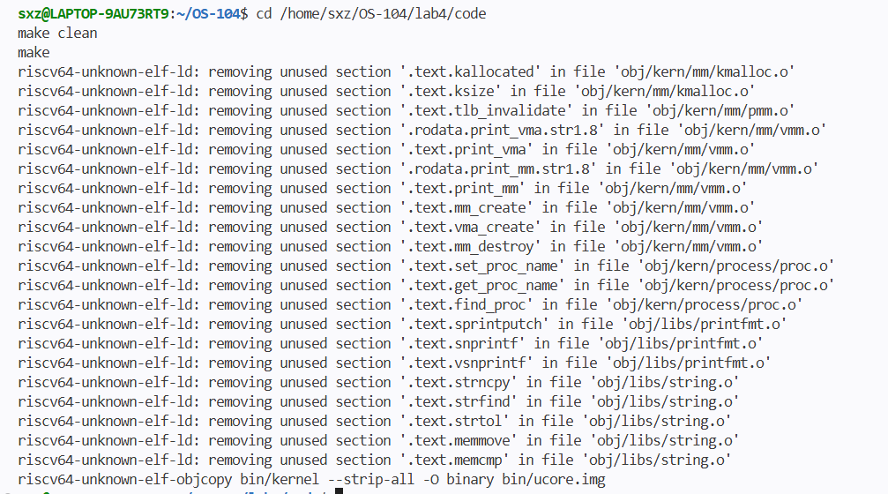
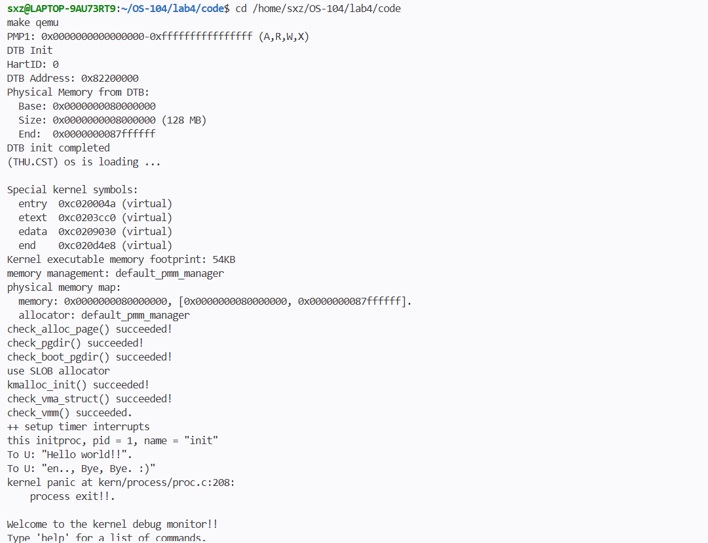
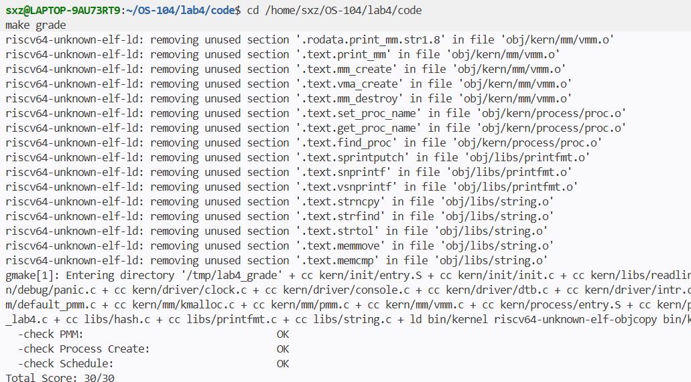

# 操作系统实验报告

## 实验基本信息

| 项目 | 内容 |
|------|------|
| **实验名称** | Lab 4：进程管理 |
| **小组成员** | 2412896-石欣哲、2412105-贺佳怡、2412634-罗茜 |
| **完成日期** | 2026-11-14 |

### 小组分工

练习分工

| 成员 | 负责的练习/模块 |
|------|----------------|
| 2412896-石欣哲 | 功能模块一：虚拟内存页操作（`page_insert` / `page_remove`）、Challenge 2、Lab2/Lab3 基线移植、最终集成 |
| 2412105-贺佳怡 | 功能模块二：进程创建与初始化（`alloc_proc`、`proc_init`、`kernel_thread`、`do_fork`、`copy_thread`、`copy_mm`） |
| 2412634-罗茜 | 功能模块三：进程调度与切换（`cpu_idle`、`schedule`、`proc_run`、`switch_to`）、Challenge 1 |

实验报告分工

Lab4 实验报告按成员负责模块拆分撰写，最后由石欣哲汇总与格式检查：

| 成员 | 报告撰写范围 |
|---|---|
| 2412896-石欣哲 | 整体逻辑线与执行链、虚拟内存页操作、`get_pte()` 职责边界、Challenge 2；本模块 spec、prompt、AI 生成 bug 及解决过程；负责报告汇总、注释与学号检查、最终集成与推送。 |
| 2412105-贺佳怡 | PCB 生命周期、`alloc_proc()`、`idleproc` / `initproc`、`kernel_thread()`、`do_fork()`、`copy_thread()`、`copy_mm()`、TrapFrame 与首次运行链路；本模块 spec、prompt、AI 生成 bug 及解决过程。 |
| 2412634-罗茜 | FIFO 调度、就绪状态选择、临界区、`proc_run()`、Sv39 `satp`、上下文切换、Challenge 1；本模块 spec、prompt、AI 生成 bug 及解决过程。 |

报告文件位于 `lab4/report/report.md`，AI 提示词汇总位于 `lab4/report/prompt.md`。各成员只负责本人模块内容，石欣哲负责最终汇总与格式统一。

> 当前版本：三个功能模块与两个 Challenge 均已完成并集成；最终 `make grade` 为 30/30。

---

## 一、实验目的

本实验的主要目的是：

1. 理解虚拟内存管理的基本结构，掌握虚拟内存的组织与管理方式。
2. 理解内核线程的创建、登记、调度与切换过程。
3. 实现从“单一执行流内核”到“支持多线程调度的内核”的过渡，为后续用户进程、系统调用、缺页异常和页面置换奠定基础。

---

## 二、实验环境

| 成员 | 宿主系统 | 交叉编译器 | 模拟器 | 编辑器 |
|---|---|---|---|---|
| 2412896-石欣哲 | WSL Ubuntu 24.04 | riscv64-unknown-elf-gcc 15.1.0 | QEMU 4.1.1 | VS Code + WSL |
| 2412105-贺佳怡 | Windows + WSL2 Ubuntu | riscv64-unknown-elf-gcc 13.2.0 | QEMU 8.2.2 | VS Code + WSL |
| 2412634-罗茜 | Intel Mac + Docker Ubuntu 22.04.5 | riscv64-unknown-elf-gcc 10.2.0 | QEMU 4.1.1 | VS Code + Docker |

**AI 工具**

| 成员 | AI 编程工具 | 底层模型 |
|---|---|---|
| 2412896-石欣哲 | Claude Code（VS Code 扩展） | DeepSeek-v4-flash |
| 2412105-贺佳怡 | Claude Code | DeepSeek-V4-Pro |
| 2412634-罗茜 | Claude Code | DeepSeek-V4-Pro |

---

## 三、实验整体逻辑分析

### 2.1 本章节的逻辑主线

Lab4 围绕“让内核能够创建、登记并轮流执行多个内核线程”展开，可以分成两条相互衔接的主线：

1. **地址空间主线**：`pmm_init()` 建立物理页管理和初始页表；`get_pte()` 负责多级页表定位与中间页表创建；`page_insert()` / `page_remove()` 负责把物理页挂到线性地址上或撤销映射；`vmm_init()` 建立 `mm_struct` / `vma_struct` 的虚拟内存描述框架。
2. **执行流主线**：`proc_init()` 把当前执行现场包装成 `idleproc`，再通过 `kernel_thread()` → `do_fork()` → `copy_thread()` 创建 `initproc`；`cpu_idle()` 在空闲时触发 `schedule()`；`schedule()` 从 `proc_list` 中选择就绪线程；`proc_run()` 更新 `current`、切换页表并调用 `switch_to()`；`switch_to()` 保存旧上下文、恢复新上下文，使新线程从 `forkret → forkrets → __trapret → kernel_thread_entry` 首次运行。

完整启动链可以概括为：

```text
kern_init -> pmm_init -> pic_init/idt_init -> vmm_init -> proc_init
          -> cpu_idle -> schedule -> proc_run -> switch_to
          -> forkret -> forkrets -> __trapret -> kernel_thread_entry
          -> init_main
```

其中前半段把地址空间和进程管理结构准备好，后半段让第一个可运行线程真正接管 CPU。

此外，Lab4 框架的 `kern/trap/trapentry.S` 仍保留了 Lab3 的占位。集成时补上了 `RESTORE_ALL` 和 `__alltraps` 中的 `mv a0, sp; jal trap`，否则首次 `sret`、时钟中断以及 `forkrets` 都无法正确恢复 TrapFrame。

### 2.2 功能的逐步实现

1. **首先实现虚拟内存页操作**。`page_insert()` / `page_remove()` 是页表从“能查”到“能改”的关键；只有映射、引用计数和 TLB 三者一致，`check_pgdir()`、`check_boot_pgdir()` 以及后续线程地址空间相关逻辑才有可靠基础。
2. **接着实现进程控制块与第一个内核线程**。`alloc_proc()` 提供干净的 PCB，`proc_init()` 把当前执行现场变成 `idleproc`，并登记到 `proc_list` 与 PID 哈希表。
3. **然后实现线程创建链路**。`kernel_thread()` 构造临时 TrapFrame，`do_fork()` 组合 PCB、内核栈和 PID，`copy_thread()` 把 TrapFrame 与 `context` 放到新线程自己的内核栈上，使 `initproc` 具备首次运行条件。
4. **最后实现调度与上下文切换**。`cpu_idle()` 检测 `need_resched`，`schedule()` 选择下一个 `PROC_RUNNABLE` 线程，`proc_run()` 在关中断临界区内切换 `current`、页表和执行现场，`switch_to()` 完成寄存器级切换。
5. **验证闭环**：`initproc` 输出规定的三行信息；评分脚本依次检查 PMM、Process Create、Schedule 三个检查点。

---

## 四、实验内容与实现

### 功能模块一：虚拟内存页操作

**负责人：** 2412896-石欣哲

#### 模块功能描述

**需要实现/修改的函数：**

```c
int page_insert(pde_t *pgdir, struct Page *page, uintptr_t la, uint32_t perm);
void page_remove(pde_t *pgdir, uintptr_t la);
```

**功能说明：**

本模块负责在现有多级页表上完成最基本的映射维护：把物理页挂到指定线性地址上，以及把已有映射安全地撤销。`page_insert()` 需要处理“地址原来未映射”“地址已映射到同一物理页”“地址已映射到其他物理页”三种情况；`page_remove()` 需要作为幂等删除接口，对未映射地址安静返回。两者共同保证页表项内容、`Page.ref` 和 TLB 状态一致。

#### 最终提示词

完整提示词见 [prompt.md](./prompt.md) 中“3. Lab4 功能模块一：`page_insert()` 与 `page_remove()`”。

#### 关键代码

**`kern/mm/pmm.c`：**

```c
//LAB4 function1 2412896
/* page_remove_pte - 撤销一个已经定位到的有效页表项，并同步引用计数与 TLB */
static void page_remove_pte(pde_t *pgdir, uintptr_t la, pte_t *ptep) {
    if (*ptep & PTE_V) {
        struct Page *page = pte2page(*ptep);
        if (page_ref_dec(page) == 0) {
            free_page(page);
        }
        *ptep = 0;
        tlb_invalidate(pgdir, la);
    }
}

/* page_insert - 在 pgdir 中建立 la -> page 的映射，权限为 perm
 * 返回 0 表示成功，-E_NO_MEM 表示中间页表分配失败 */
int page_insert(pde_t *pgdir, struct Page *page, uintptr_t la, uint32_t perm) {
    pte_t *ptep = get_pte(pgdir, la, 1);
    if (ptep == NULL) {
        return -E_NO_MEM;
    }

    page_ref_inc(page);

    if (*ptep & PTE_V) {
        struct Page *old_page = pte2page(*ptep);
        if (old_page == page) {
            /* 同一物理页重复映射到同一地址：只更新权限，不重复增加引用 */
            page_ref_dec(page);
        } else {
            /* 原地址映射到其他物理页：先完整撤销旧映射 */
            page_remove_pte(pgdir, la, ptep);
        }
    }

    *ptep = pte_create(page2ppn(page), perm);
    tlb_invalidate(pgdir, la);
    return 0;
}

/* page_remove - 幂等删除 la 处的映射；未映射时安静返回 */
void page_remove(pde_t *pgdir, uintptr_t la) {
    pte_t *ptep = get_pte(pgdir, la, 0);
    if (ptep != NULL) {
        page_remove_pte(pgdir, la, ptep);
    }
}
```

**三个一致性的处理方式：**

1. **页表项**：只有 `get_pte()` 成功返回后才写 PTE；替换旧映射时先调用 `page_remove_pte()` 清空旧项，再写入新项。
2. **引用计数**：先 `page_ref_inc(page)`，同一页重复映射时再 `page_ref_dec(page)` 抵消；旧页通过 `page_remove_pte()` 统一减引用，归零时 `free_page()`。
3. **TLB**：每次 PTE 内容发生变化后都调用 `tlb_invalidate(pgdir, la)`，避免 CPU 继续使用旧翻译。

#### 实现迭代过程

##### 第一次迭代

第一版提示词只描述了“建立/删除映射”，没有明确“同一物理页重复映射同一地址”和“替换旧映射”的区别。按第一版提示词生成的实现，在每次 `page_insert()` 都无条件增加引用计数；我在核对 `check_pgdir()` 断言时发现，如果原 PTE 已经指向同一物理页，引用计数会多加 1，`assert(page_ref(p1) == 1)` 会失败。

**修正：** 在行为规格中补充两条分支：

- 原 PTE 有效且 `pte2page(*ptep) == page`：只更新权限，回退本次引用增量；
- 原 PTE 有效且指向其他页：先调用 `page_remove_pte()` 撤销旧映射。

##### 第二次迭代

我在提示词的行为规格中补充了 TLB 一致性要求后，实现中在 `page_insert()` 和 `page_remove_pte()` 末尾都加入了 `tlb_invalidate(pgdir, la)`。随后我重新编译，并在临时验证副本中逐条对照断言运行，`check_pgdir()` 与 `check_boot_pgdir()` 全部通过，注入测试输出 `[Test PMM] PASS`。

**最终结果：**

- ✅ 编译通过；
- ✅ `check_pgdir()` / `check_boot_pgdir()` 通过；
- ✅ `[Test PMM] PASS`。

---

### 功能模块二：进程创建与初始化

**负责人：** 2412105-贺佳怡

#### 模块功能描述

**需要实现/修改的函数：**

```c
static struct proc_struct *alloc_proc(void);
void proc_init(void);
int kernel_thread(int (*fn)(void *), void *arg, uint32_t clone_flags);
int do_fork(uint32_t clone_flags, uintptr_t stack, struct trapframe *tf);
static void copy_thread(struct proc_struct *proc, uintptr_t esp, struct trapframe *tf);
static int copy_mm(uint32_t clone_flags, struct proc_struct *proc);
```

**功能说明：**

本模块把系统中“已经能运行内核代码”推进到“能创建并登记多个内核线程”。`alloc_proc()` 分配并清零 PCB；`proc_init()` 把当前执行现场包装成 `idleproc`，再通过 `kernel_thread()` 创建 `initproc`；`do_fork()` 组合 PCB、内核栈、PID、链表和哈希表；`copy_thread()` 把 TrapFrame 和 `context` 放到新线程自己的内核栈上；`copy_mm()` 在 Lab4 只保留接口。

#### 最终提示词

完整提示词见 [prompt.md](./prompt.md) 中“2412105-贺佳怡”部分。

#### 关键代码

**`alloc_proc()`：**

```c
static struct proc_struct *
alloc_proc(void) {
    struct proc_struct *proc = kmalloc(sizeof(struct proc_struct));
    if (proc == NULL) {
        return NULL;
    }

    proc->state = PROC_UNINIT;
    proc->pid = -1;
    proc->runs = 0;
    proc->kstack = 0;
    proc->need_resched = 0;
    proc->parent = NULL;
    proc->mm = NULL;

    memset(&proc->context, 0, sizeof(struct context));

    proc->tf = NULL;
    proc->pgdir = boot_pgdir_pa;
    proc->flags = 0;
    memset(proc->name, 0, sizeof(proc->name));

    list_init(&(proc->list_link));
    list_init(&(proc->hash_link));

    return proc;
}
```

`proc_init()` 先初始化 `proc_list` 和 `hash_list`，再创建 PID 0 的 `idleproc`：状态 `PROC_RUNNABLE`、`kstack = bootstack`、`need_resched = 1`、`current = idleproc`；随后调用 `kernel_thread(init_main, "Hello world!!", 0)`，用 `find_proc()` 找到 PID 1 的 `initproc` 并命名为 "init"。

**`kernel_thread()` 与 `copy_thread()`：**

```c
int
kernel_thread(int (*fn)(void *), void *arg, uint32_t clone_flags) {
    struct trapframe tf;
    memset(&tf, 0, sizeof(struct trapframe));

    tf.gpr.s0 = (uintptr_t)fn;
    tf.gpr.s1 = (uintptr_t)arg;
    tf.epc = (uintptr_t)kernel_thread_entry;

    uintptr_t status = read_csr(sstatus);
    tf.status = (status | SSTATUS_SPP | SSTATUS_SPIE) & ~SSTATUS_SIE;

    return do_fork(clone_flags, 0, &tf);
}
```

```c
static void
copy_thread(struct proc_struct *proc, uintptr_t esp, struct trapframe *tf) {
    proc->tf = (struct trapframe *)(proc->kstack + KSTACKSIZE) - 1;
    *(proc->tf) = *tf;

    proc->tf->gpr.a0 = 0;
    proc->tf->gpr.sp = (esp == 0) ? (uintptr_t)proc->tf : esp;

    proc->context.ra = (uintptr_t)forkret;
    proc->context.sp = (uintptr_t)(proc->tf);
}
```

`kernel_thread()` 把 `fn` 和 `arg` 放进 `s0`/`s1`，把返回地址设为 `kernel_thread_entry`，并按当前 `sstatus` 设置 SPP/SPIE、清除 SIE；`copy_thread()` 在内核栈顶放置 TrapFrame，把 `a0` 置 0 区分父子返回值，把 `context.ra` 设为 `forkret`，从而形成 `switch_to -> forkret -> forkrets -> __trapret -> kernel_thread_entry -> fn(arg)` 的首次运行链。

**`do_fork()` 的失败清理：**

`do_fork()` 依次完成 PCB 分配、内核栈分配、`copy_mm()`、`copy_thread()`、PID 分配、链表/哈希表挂接和 `wakeup_proc()`。任一前置步骤失败时，分别执行 `put_kstack()` 和 `kfree()`，避免内核栈或 PCB 泄漏；成功时返回新进程 PID。

#### 实现迭代过程

##### 第一次迭代

第一版实现把 `copy_thread()` 和 `copy_mm()` 的定义放在 `do_fork()` 之后，编译报：

```text
implicit declaration of function 'copy_thread'
```

原因是 C 编译器在 `do_fork()` 处看不到这两个函数的声明。修正方式是在 `//LAB4 function2` 区域顶部补两条 `static` 前置声明：

```c
static void copy_thread(struct proc_struct *proc, uintptr_t esp, struct trapframe *tf);
static int copy_mm(uint32_t clone_flags, struct proc_struct *proc);
```

##### 第二次迭代

在 WSL 环境下 `make grade` 曾报 `no $qemu_out`。排查后确认不是代码错误，而是本地 QEMU 版本与 `grade.sh` 的启动参数/输出重定向差异；直接用 `make qemu` 能完整输出 `initproc` 结果，代码逻辑没有问题。最终在 GCC 15.1 / QEMU 4.1.1 集成环境中 `make grade` 通过。

**最终结果：**

- ✅ 编译通过；
- ✅ `[Test Process Create] PASS`；
- ✅ `idleproc` / `initproc` 字段与父子关系符合测试断言。

---

### 功能模块三：进程调度与切换

**负责人：** 2412634-罗茜

#### 模块功能描述

**需要实现/修改的函数：**

```c
void cpu_idle(void);
void schedule(void);
void proc_run(struct proc_struct *proc);
void switch_to(struct context *from, struct context *to);
```

**功能说明：**

`cpu_idle()` 是 `idleproc` 的执行主体；`schedule()` 从 `proc_list` 中选择下一个 `PROC_RUNNABLE` 线程；`proc_run()` 在关中断临界区中更新 `current`、切换 Sv39 页表、刷新 TLB 并调用 `switch_to()`；`switch_to()` 只负责 `struct context` 的寄存器保存与恢复。

#### 最终提示词

完整提示词见 [prompt.md](./prompt.md) 中“2412634-罗茜”部分。

#### 关键代码

**`cpu_idle()`：**

```c
void cpu_idle(void) {
    while (1) {
        if (current->need_resched) {
            schedule();
        }
    }
}
```

`proc_init()` 把 `idleproc->need_resched` 置 1，因此内核第一次进入 `cpu_idle()` 时就会调用 `schedule()`，把 CPU 交给 `initproc`。

**`schedule()`：**

```c
void schedule(void) {
    bool intr_flag;
    list_entry_t *le, *last;
    struct proc_struct *next = NULL;

    local_intr_save(intr_flag);
    {
        current->need_resched = 0;
        last = (current == idleproc) ? &proc_list : &(current->list_link);
        le = last;
        do {
            le = list_next(le);
            if (le != &proc_list) {
                next = le2proc(le, list_link);
                if (next->state == PROC_RUNNABLE) {
                    break;
                }
            }
        } while (le != last);

        if (next == NULL || next->state != PROC_RUNNABLE) {
            next = idleproc;
        }

        next->runs++;
        if (next != current) {
            proc_run(next);
        }
    }
    local_intr_restore(intr_flag);
}
```

当前线程不是 `idleproc` 时从后继节点扫描，是 `idleproc` 时从链表头扫描；跳过链表头哨兵，只选择 `PROC_RUNNABLE`，找不到时回退 `idleproc`。

**`proc_run()` 与 Sv39 `satp`：**

```c
void proc_run(struct proc_struct *proc) {
    if (proc == current) {
        return;
    }

    assert(proc->state == PROC_RUNNABLE);
    bool intr_flag;
    struct proc_struct *prev = current;
    struct proc_struct *next = proc;

    local_intr_save(intr_flag);
    {
        current = next;
        write_csr(satp,
                  0x8000000000000000 | (next->pgdir >> RISCV_PGSHIFT));
        flush_tlb();
        switch_to(&(prev->context), &(next->context));
    }
    local_intr_restore(intr_flag);
}
```

`pgdir` 是页表根节点物理地址，写入 `satp` 前右移 `RISCV_PGSHIFT`；模式位使用 Sv39（`8 << 60`），与 `pmm.c::enable_paging()` 一致。不能使用遗留的 Sv32 `lsatp()`。

**`switch_to()` 的寄存器偏移：**

`struct context` 顺序为 `ra, sp, s0..s11`，RV64 每个字段 8 字节，偏移依次为：

```text
ra=0, sp=8, s0=16, s1=24, s2=32, s3=40, s4=48, s5=56,
s6=64, s7=72, s8=80, s9=88, s10=96, s11=104
```

已用 `objdump -d obj/kern/process/switch.o` 核对保存/恢复顺序与 `struct context` 一致。

#### 实现迭代过程

1. 先核对 `proc.h` 的 `struct context` 字段顺序，没有沿用 x86 或其他实验的偏移。
2. 发现 `libs/riscv.h::lsatp()` 使用 Sv32 编码，不能用于 RV64；参考 `pmm.c::enable_paging()` 改为 Sv39。
3. `schedule()` 的链表扫描使用环形 `do-while`，单独处理链表头哨兵和 `next` 非就绪的情况。
4. 用反汇编核对 `switch_to` 的实际偏移，确认保存与恢复顺序一致。
5. 在隔离的 `/tmp` 临时副本中补入临时 function2 和 Trap 返回链，完整评分通过；临时依赖没有提交到正式分支。

**最终结果：**

- ✅ 编译通过；
- ✅ `[Test Schedule] PASS`；
- ✅ `initproc` 三行输出。

---

### Challenge 1：`local_intr_save/restore` 如何开关中断

**负责人：** 2412634-罗茜

`local_intr_save(intr_flag)` 展开后调用 `__intr_save()`：

1. 读取当前 `sstatus.SIE`；
2. 如果中断原本开启，则调用 `intr_disable()`，并把 `true` 写入 `intr_flag`；
3. 如果中断原本关闭，则不做任何操作，并把 `false` 写入 `intr_flag`。

`local_intr_restore(intr_flag)` 根据保存值决定是否恢复：`true` 表示进入临界区前中断开启，退出时调用 `intr_enable()`；`false` 表示进入前已经关闭，退出时保持关闭。它保存并恢复的是调用前的局部中断状态，而不是无条件开中断，因此支持嵌套临界区：外层已经关闭中断时，内层恢复不会提前开启。

它保护的是单处理器上的“检查条件—更新状态—执行切换”操作，例如 `schedule()` 中选择 `next`、更新 `need_resched` 和调用 `proc_run()`，以及 `proc_run()` 中更新 `current`、写入 `satp` 和执行 `switch_to()`。它不等价于多核自旋锁，也不保证多 CPU 之间的互斥；多核并发仍需要额外的原子操作或锁机制。

---

### Challenge 2：分页模式与 `get_pte()` 的职责边界

**负责人：** 2412896-石欣哲

#### 2.1 `get_pte()` 中两段相似代码的原因

`get_pte()` 的两段代码分别处理 Sv39 的 `PDX1`（一级页目录）和 `PDX0`（二级页目录）。两段代码形式相似，是因为多级页表的每一级在做同一件事：

1. 用当前级的 9 位索引取出表项；
2. 若表项无效且 `create == 1`，分配一个物理页作为下一级页表；
3. 把物理页清零、引用计数置 1；
4. 用 `pte_create(page2ppn(page), PTE_U | PTE_V)` 写入当前级表项；
5. 通过 `PDE_ADDR()` 取出下一级页表的物理地址，再经 `KADDR()` 转成内核虚拟地址，进入下一级。

Sv32、Sv39、Sv48 的差异主要在“层数、索引位宽、地址宽度”：

| 模式 | 虚拟地址宽度 | 页表级数 | 每级索引位数 | PTE 宽度 | 物理地址宽度 |
|---|---|---|---|---|---|
| Sv32 | 32 位 | 2 级 | 10 位 | 32 位 | 34 位 |
| Sv39 | 39 位 | 3 级 | 9 位 | 64 位 | 56 位 |
| Sv48 | 48 位 | 4 级 | 9 位 | 64 位 | 56 位 |

不变的是“从当前表项找到下一张表”的基本模式：非叶子 PTE 的 PPN 都指向下一级页表，权限位和有效位的含义一致；只有最后一级才得到真正映射数据页的叶子 PTE。因此，Sv39 的 `get_pte()` 只需要两段“建表”代码，最后用 `PTX(la)` 返回叶子 PTE；移植到 Sv48 时增加一段同样形式的代码，移植到 Sv32 时减少一段并调整移位与掩码即可。层数变化改变的是循环次数和索引宽度，而不是每一级的访问方式。

#### 2.2 把“查找 PTE”和“分配页表页”放在同一个函数里是否合理

**当前写法的优点：**

- 调用点简单：`boot_map_segment()`、`page_insert()` 只需要调用 `get_pte(pgdir, la, create)`，不必关心当前是第几级、是否需要建表。
- 建表逻辑集中：中间页表的分配、清零、引用计数和权限设置只写一次，避免在多个调用点重复。
- 与 ucore 的教学结构一致：`create` 参数把“只查找”和“查找并创建”统一在一个接口里，便于理解多级页表。

**当前写法的缺点：**

- 职责不单一：`get_pte()` 同时承担“页表遍历”和“页表页分配”，错误处理边界不够清晰。例如一级页表分配成功、二级页表分配失败时，函数返回 `NULL`，但一级页表页已经挂上，调用者很难判断是否需要回收。
- 复用性受限：如果后续实现缺页异常、写时复制或用户态拷贝，往往需要“只查找、不分配”的纯遍历接口；此时只能依赖 `create == 0` 的分支，接口语义不够直观。
- 测试与调试成本更高：想单独验证“遍历”或“建表”时，必须构造完整的 `create` 场景。

**是否拆分：**

一种更清晰的设计是拆成：

```c
pte_t *walk_pte(pde_t *pgdir, uintptr_t la);              /* 只查找，不分配 */
int alloc_page_table(pde_t *pgdir, uintptr_t la);         /* 必要时创建中间页表 */
pte_t *get_pte(pde_t *pgdir, uintptr_t la, bool create);  /* 兼容包装 */
```

拆分后，`page_remove()`、`get_page()` 可以调用纯查找接口，语义更明确；`page_insert()` 显式先建表再写叶子 PTE，错误处理也更清楚。代价是调用点和代码量增加，而且需要把“部分建表失败”的清理责任明确下来。

**结论：** 对 Lab4 当前“预映射、无缺页处理”的使用场景，现有写法足够，且与框架其他代码保持一致；如果后续实验要加入按需分页、写时复制或更复杂的错误恢复，建议拆分出纯遍历接口，把分配策略和遍历逻辑解耦。

---

## 五、测试与验证

### 5.1 PMM 模块验证

在临时验证副本中为尚未实现的 `proc_init()` / `cpu_idle()` 加入空桩（仅用于本地验证，不提交），启动输出如下：

```text
memory management: default_pmm_manager
physical memory map:
  memory: 0x0000000080000000, [0x0000000080000000, 0x0000000087ffffff].
  allocator: default_pmm_manager
check_alloc_page() succeeded!
check_pgdir() succeeded!
check_boot_pgdir() succeeded!
use SLOB allocator
kmalloc_init() succeeded!
check_vma_struct() succeeded!
check_vmm() succeeded.
++ setup timer interrupts
```

注入 `tools/test_lab4.c` 后，PMM 检查点输出：

```text
[Test PMM] PASS
```

该检查覆盖了：

- 首次映射后 `page_ref(p1) == 1`；
- 同一地址替换物理页后旧页引用归零；
- 同一物理页重复插入同一地址时引用计数不重复增加、空闲页数不变；
- 重复 `page_remove()` 的幂等性；
- 删除映射后引用计数归零。

### 5.2 完整评分

三个功能模块与 Trap 入口基线合并后，在 WSL Ubuntu 24.04、GCC 15.1.0、QEMU 4.1.1 环境下执行 `make grade`，结果如下：

```text
  -check PMM:                                OK
  -check Process Create:                     OK
  -check Schedule:                           OK
Total Score: 30/30
```

`make qemu` 中 `initproc` 的规定输出为：

```text
this initproc, pid = 1, name = "init"
To U: "Hello world!!".
To U: "en.., Bye, Bye. :)"
```

这三行之后会出现 `do_exit()` 的 `panic("process exit!!.")`。这是 Lab4 框架中 `do_exit()` 仍为占位实现导致的预期现象：`init_main()` 返回后 `kernel_thread_entry` 会跳转到 `do_exit()`，评分脚本在读取到三行输出后已经完成 Schedule 检查。

### 5.3 测试截图

**编译成功（`make clean && make`）：**



**QEMU 运行与 `initproc` 输出（`make qemu`）：**



**完整评分（`make grade`）：**



---

## 六、实验总结与收获

### 对操作系统的理解

#### 本实验中的重要知识点与 OS 原理的对应关系

| 实验中的知识点 | OS 原理中的对应概念 | 含义、关系与差异 |
|---|---|---|
| `get_pte()` 多级页表遍历 | 分页式虚拟内存、页表项 | 原理中页表把虚拟地址翻译为物理地址；实验中用 Sv39 三级页表实现，`get_pte()` 负责定位叶子 PTE。差异是本实验采用预映射，不涉及缺页分配。 |
| `page_insert()` / `page_remove()` | 地址映射建立与撤销、引用计数 | 原理中映射是虚拟页到物理页的绑定；实验中还必须维护 `Page.ref` 和 TLB，否则会出现“页表已改、CPU 仍用旧翻译”。 |
| `tlb_invalidate()` / `sfence.vma` | TLB 与地址翻译缓存 | 原理中 TLB 是页表的高速缓存；RISC-V 写 `satp` 不会自动刷新 TLB，需要显式 `sfence.vma`。 |
| `struct proc_struct` | 进程控制块 PCB | 原理中 PCB 保存进程状态、资源和执行现场；实验中的 PCB 还包含内核栈、`context`、`trapframe`、页目录基址等 RISC-V 相关字段。 |
| `idleproc` / `initproc` | 空闲进程、初始进程 | 原理中空闲进程在无任务时占住 CPU；实验中 `idleproc` 复用启动现场，`initproc` 由 `kernel_thread()` 创建，所有线程共享内核地址空间。 |
| `context` / `switch_to()` | 上下文切换 | 原理中切换需要保存/恢复寄存器；实验只保存 callee-saved 寄存器（`ra`、`sp`、`s0`~`s11`），caller-saved 由编译器在函数调用边界处理。 |
| `schedule()` | 调度器与调度策略 | 原理中有 FCFS、轮转、优先级等策略；实验实现最简单的 FIFO/轮转，只在 `cpu_idle()` 等调度点触发。 |
| `local_intr_save/restore` | 临界区与中断屏蔽 | 原理中用关中断保护共享状态；实验用保存/恢复 `sstatus.SIE` 的方式保护 `schedule()` 和 `proc_run()` 的关键区，只适用于单核。 |

#### OS 原理中重要、但本实验未覆盖的知识点

1. **按需分页与缺页异常处理**：实验中所有映射在建立地址空间时一次性完成，`do_pgfault()` 仍是框架占位；原理中的 demand paging、页面置换（LRU、Clock 等）没有真正运行。
2. **用户态与内核态隔离**：本实验只创建内核线程，所有线程共享内核地址空间，没有用户进程、系统调用和 `PTE_U` 权限隔离的完整验证。
3. **多核并发与锁**：`local_intr_save/restore` 只解决单核中断竞争，没有自旋锁、原子操作、内存屏障等多核同步机制。
4. **进程退出与资源回收**：`do_exit()` 仍是 `panic`，没有完整的僵尸进程、父进程回收、等待队列和 PID 复用处理。
5. **进程间通信与文件系统**：本实验不涉及管道、共享内存、信号和文件描述符等资源管理。

### AI 协作开发的经验

本实验的分工是：我负责梳理功能需求、划定可修改边界、编写 spec 与提示词、审查生成结果、编译运行并定位问题；AI 负责按提示词给出初版实现和解释。下面几点是实际协作中总结出的经验。

1. **提示词要写“边界”而不是“步骤”**：把可修改文件、不可修改的测试与数据结构、失败时的返回值写清楚，比逐行描述实现更能让 AI 产出符合框架的代码。
2. **行为规格要覆盖分支**：`page_insert()` 的“同一页重复映射”和“替换旧页”就是典型例子；不写清楚，生成结果很容易漏掉引用计数分支。
3. **生成结果必须由我逐条核对一致性**：页表项、`Page.ref`、TLB 三者是否同步，必须结合 `check_pgdir()` 的断言逐条验证，不能只看“能编译”。
4. **工具链差异要单独记录**：GCC 15 默认把 `-Wincompatible-pointer-types` 当错误，GCC 13 只是警告；这类问题应写进 prompt 的“依赖/验证”部分，避免队友重复踩坑。
