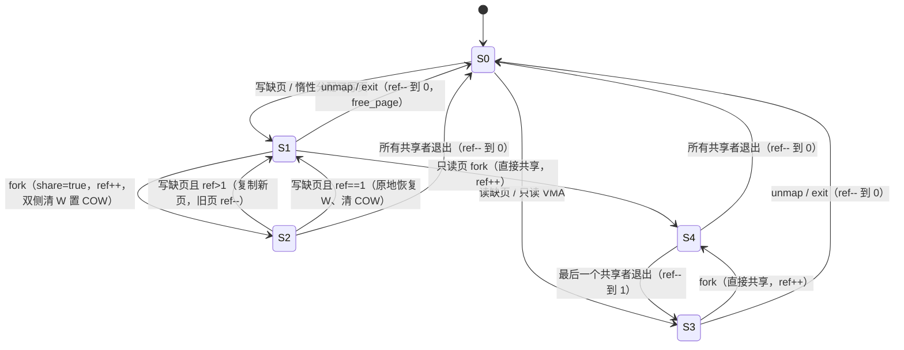

# Lab5 报告素材（2412105 贺佳怡）


---

## 功能模块三：fork 和地址空间复制

**负责人：** 2412105-贺佳怡

### 1. 模块功能描述

**需要实现/修改的函数：**

```c
/* kern/process/proc.c */
int  do_fork(uint32_t clone_flags, uintptr_t stack, struct trapframe *tf);
static int  copy_mm(uint32_t clone_flags, struct proc_struct *proc);
static void copy_thread(struct proc_struct *proc, uintptr_t esp, struct trapframe *tf);

/* kern/mm/pmm.c */
int copy_range(pde_t *to, pde_t *from, uintptr_t start, uintptr_t end, bool share);

/* kern/mm/vmm.c */
int dup_mmap(struct mm_struct *to, struct mm_struct *from);
```

`fork` 的目标是让子进程获得一份与父进程「逻辑等价、物理可独立演化」的地址空间。本模块负责
从 PCB 分配、内核栈建立、地址空间复制，到 trapframe 与上下文初始化的整条链路，并且为后面的
COW 提供可回滚的页面复制基础。

**设计要点：**

1. `proc->pgdir` 保存的是**页表物理地址**。`proc_run` 把它右移 12 位写入 `satp`，若存虚拟地址，
   子进程第一次被调度就会跳飞。内核线程没有用户地址空间，直接沿用 `boot_pgdir_pa`。
2. `CLONE_VM` 表示线程共享地址空间，只增加 `mm_count`，不复制页面。
3. 普通 fork 新建 `mm` 与页表，`setup_pgdir` 先把内核映射拷进来，再 `dup_mmap` 复制 VMA 和页面。
4. `copy_thread` 把父进程的 trapframe 拷到子进程内核栈顶，`a0 = 0`（子进程 fork 返回 0），
   `ra = forkret`（第一次调度经 `forkrets` 恢复 trapframe 返回用户态）。
5. 任何一个环节失败都必须分级回退，不能留下半成品 PCB、内核栈或地址空间。

### 2. 核心实现

**`do_fork`：按「PCB → 内核栈 → 地址空间 → 上下文 → 挂入全局结构」的顺序创建子进程。**

```c
int do_fork(uint32_t clone_flags, uintptr_t stack, struct trapframe *tf)
{
    int ret = -E_NO_FREE_PROC;
    struct proc_struct *proc;

    if (nr_process >= MAX_PROCESS) {
        goto fork_out;
    }
    ret = -E_NO_MEM;

    if ((proc = alloc_proc()) == NULL) {
        goto fork_out;
    }
    proc->parent = current;

    if (setup_kstack(proc) != 0) {
        goto bad_fork_cleanup_proc;
    }

    if (copy_mm(clone_flags, proc) != 0) {
        goto bad_fork_cleanup_kstack;
    }

    copy_thread(proc, stack, tf);

    /* pid 分配与挂链必须在关中断临界区内完成 */
    bool intr_flag;
    local_intr_save(intr_flag);
    {
        proc->pid = get_pid();
        hash_proc(proc);
        set_links(proc);
    }
    local_intr_restore(intr_flag);

    wakeup_proc(proc);
    ret = proc->pid;

fork_out:
    return ret;

bad_fork_cleanup_kstack:
    put_kstack(proc);
bad_fork_cleanup_proc:
    kfree(proc);
    goto fork_out;
}
```

**`copy_mm`：区分内核线程、线程（CLONE_VM）和普通进程三种情况。**

```c
static int copy_mm(uint32_t clone_flags, struct proc_struct *proc)
{
    struct mm_struct *mm, *oldmm = current->mm;

    /* 内核线程：沿用内核页表 */
    if (oldmm == NULL) {
        proc->mm = NULL;
        proc->pgdir = boot_pgdir_pa;
        return 0;
    }

    /* 线程：共享同一地址空间 */
    if (clone_flags & CLONE_VM) {
        mm_count_inc(oldmm);
        proc->mm = oldmm;
        proc->pgdir = current->pgdir;
        return 0;
    }

    /* 普通 fork：新建 mm 与独立页表 */
    if ((mm = mm_create()) == NULL) {
        return -E_NO_MEM;
    }
    if (setup_pgdir(mm) != 0) {
        mm_destroy(mm);
        return -E_NO_MEM;
    }

    lock_mm(oldmm);
    int ret = dup_mmap(mm, oldmm);
    unlock_mm(oldmm);

    if (ret != 0) {
        /* dup_mmap 可能留下部分 VMA/页面，统一回收 */
        exit_mmap(mm);
        put_pgdir(mm);
        mm_destroy(mm);
        return ret;
    }

    mm_count_inc(mm);
    proc->mm = mm;
    proc->pgdir = PADDR(mm->pgdir);   /* satp 需要物理地址 */
    return 0;
}
```

**`copy_thread`：trapframe 布局与 fork 返回值的来源。**

```c
static void copy_thread(struct proc_struct *proc, uintptr_t esp, struct trapframe *tf)
{
    proc->tf = (struct trapframe *)(proc->kstack + KSTACKSIZE) - 1;
    *(proc->tf) = *tf;

    proc->tf->gpr.a0 = 0;                       /* 子进程从 fork 返回 0 */
    proc->tf->gpr.sp = (esp == 0) ? (uintptr_t)proc->tf : esp;
    proc->context.ra = (uintptr_t)forkret;      /* 首次调度从 forkret 开始 */
    proc->context.sp = (uintptr_t)proc->tf;
}
```

**`dup_mmap`：复制 VMA 链表并逐段调用 `copy_range`。**

```c
int dup_mmap(struct mm_struct *to, struct mm_struct *from)
{
    assert(to != NULL && from != NULL);
    assert(to->pgdir != NULL && from->pgdir != NULL);

    list_entry_t *list = &(from->mmap_list);
    list_entry_t *le = list;

    while ((le = list_next(le)) != list) {
        struct vma_struct *vma = le2vma(le, list_link);

        struct vma_struct *new_vma =
            vma_create(vma->vm_start, vma->vm_end, vma->vm_flags);
        if (new_vma == NULL) {
            return -E_NO_MEM;
        }
        insert_vma_struct(to, new_vma);

        if (copy_range(to->pgdir, from->pgdir,
                       vma->vm_start, vma->vm_end, 1) != 0) {
            return -E_NO_MEM;   /* 由 copy_mm 统一清理 */
        }
    }
    return 0;
}
```

**`copy_range`：深拷贝分支（普通 fork 阶段用于先把链路跑通）。**

```c
for (addr = start; addr < end; addr += PGSIZE) {
    pte_t *src_ptep = get_pte(from, addr, 0);
    if (src_ptep == NULL || !(*src_ptep & PTE_V)) {
        continue;                       /* 允许惰性分配，未建立的不复制 */
    }
    struct Page *src_page = pte2page(*src_ptep);
    uint32_t perm = *src_ptep & 0x3FF;

    struct Page *dst_page = alloc_page();
    if (dst_page == NULL) {
        goto failed;
    }
    memcpy(KADDR(page2pa(dst_page)), KADDR(page2pa(src_page)), PGSIZE);
    perm &= ~PTE_COW;

    if (page_insert(to, dst_page, addr, perm) != 0) {
        free_page(dst_page);
        goto failed;
    }
}
return 0;

failed:
    unmap_range(to, start, addr);       /* 撤销 to 中已建立的映射，并减少引用计数 */
    return -E_NO_MEM;
```

> 深拷贝版本先保证 `badarg` / `forktest` 全过；稳定后再把 `share` 改为 `1` 接入 COW，
> 避免「普通 fork 未稳就上 COW」导致问题无法定位。

### 3. 最终提示词

以下是本模块最终收敛后的提示词（完整迭代见 prompt 记录）：

````markdown
在 ucore RISC-V (Sv39) 上实现 Lab5 的普通 fork 和地址空间复制，只修改我负责的函数：
- kern/process/proc.c: do_fork / copy_mm / copy_thread
- kern/mm/pmm.c: copy_range
- kern/mm/vmm.c: dup_mmap
不要修改 syscall.c、trap.c、do_exit/do_wait/do_kill。

约束：
1. proc->pgdir 必须是页表物理地址（proc_run 用它写 satp）；内核线程用 boot_pgdir_pa。
2. copy_thread: trapframe 放在 kstack + KSTACKSIZE - sizeof(trapframe)；
   a0 = 0；ra = forkret；用户进程 sp = 父进程 sp，内核线程 sp = 新 trapframe。
3. copy_mm: 内核线程沿用内核页表；CLONE_VM 只增加 mm_count；
   普通 fork 新建 mm + setup_pgdir + dup_mmap；失败时 exit_mmap + put_pgdir + mm_destroy。
4. dup_mmap 保持 VMA 顺序和 vm_flags，逐段 copy_range(..., share)。
5. copy_range 先实现 share=false 深拷贝；任何一步失败用 unmap_range 回滚已建立映射。
6. 本轮不实现 COW，目标是 badarg 和 forktest 全部通过。
请给出完整函数实现，并逐项说明引用计数的变化。
````

### 4. 实现迭代过程

#### 第一次迭代：拉通 do_fork / copy_thread

**遇到的问题：**

- 子进程第一次被调度时没有从用户态正确返回，`fork` 返回值也不对。
- 内核线程与用户进程的栈指针处理混在一起。

**问题解决策略：**

- 把 trapframe 固定放在内核栈顶（`kstack + KSTACKSIZE - sizeof(tf)`），`context.sp` 指向它，
  `context.ra` 指向 `forkret`；`a0` 清零保证子进程返回 0。
- 区分 `esp == 0`（内核线程）与用户进程：前者 `sp` 指向新 trapframe，后者沿用父进程用户栈。

**结果：** `badarg` 的 `fork ok.` 能打印，子进程能正常 `exit`。

#### 第二次迭代：地址空间复制与页表物理地址

**遇到的问题：**

- fork 后子进程第一次运行就异常，`satp` 装载后地址空间不对。
- `dup_mmap` 复制出的页面与父进程共享了物理页，但权限没有区分。

**问题解决策略：**

- `proc->pgdir` 统一保存 `PADDR(mm->pgdir)`；内核线程保存 `boot_pgdir_pa`。
- `setup_pgdir` 先 `memcpy` 内核映射，再复制用户 VMA；`copy_range` 用 `share=false`
  深拷贝，`perm` 去掉 `PTE_COW`，每个新页引用计数为 1。

**结果：** `forktest` 32 个子进程全部创建和回收成功，`forktest pass.`。

#### 第三次迭代：失败路径与回滚

**遇到的问题：**

- 分配失败时，子进程页表里残留部分映射，父进程页面的引用计数也不回退。
- `copy_mm` 失败后直接返回，已插入的 VMA 和页表没有释放。

**问题解决策略：**

- `copy_range` 失败时 `unmap_range(to, start, addr)` 撤销已建立映射，引用计数随 `page_remove_pte` 回退。
- `copy_mm` 在 `dup_mmap` 失败后执行 `exit_mmap + put_pgdir + mm_destroy`，保证 `mm_count == 0` 时销毁。
- 父进程一侧的 COW 权限恢复在 COW 阶段补齐（见下一节）。

**结果：** 失败路径不再泄漏页面；回滚验证见「COW Challenge」一节。

### 5. 最终结果

- [x] 编译通过（GCC 13.2.0，无新增告警）
- [x] `badarg`、`forktest` 通过
- [x] 父进程退出后空闲页数恢复
- [x] 失败路径可回滚，无残留映射

---

## COW Challenge：写时复制

**负责人：** 2412105-贺佳怡

### 1. 设计思路

普通 fork 如果对每个可写页都深拷贝，`forktest` 这类场景会成倍消耗物理页。COW 的做法是：
**fork 时只复制页表项、共享物理页，并把可写页在父子两侧都改成只读 + `PTE_COW`；
任意一方第一次写时触发缺页，由缺页处理复制出私有页。**

`PTE_COW` 使用 PTE 的软件保留位：

```c
#define PTE_COW 0x100   // bit 8，仅软件使用
```

**不变量：**

1. 带 `PTE_COW` 的页一定被至少两个进程共享，且 PTE 必须是只读的（`PTE_W = 0`）。
2. 私有页不得带 `PTE_COW`。
3. 共享页永远不原地写；写操作只能落在复制出的新页上。
4. 物理页引用计数归零才释放。

### 2. COW 页面状态机

把「一个用户虚拟页对应的物理页 + 它的 PTE」看作状态机的对象：

| 状态 | PTE 特征 | 引用计数 | 含义 |
|---|---|---|---|
| `S0 未映射` | `V=0` | — | 惰性分配，尚未建立映射 |
| `S1 私有可写` | `V=1, W=1, COW=0` | 1 | 只有一个进程使用，可直接写 |
| `S2 共享只读（COW）` | `V=1, W=0, COW=1` | ≥2 | fork 后共享，任一方写都要复制 |
| `S3 私有只读` | `V=1, W=0, COW=0` | 1 | 只读段（如代码页） |
| `S4 共享只读` | `V=1, W=0, COW=0` | ≥2 | 只读页直接共享，不需要 COW |



**关键转换说明：**

- `S1 → S2`：fork 时 `copy_range(share=true)` 对可写页执行 `PTE_COW | ~PTE_W`，
  `page_insert` 使引用计数 +1；父进程 PTE 也同步改成只读 + COW，否则父进程写不会触发缺页。
- `S2 → S1`（ref > 1）：缺页处理分配新页、`memcpy`，新页权限
  `perm = (旧 PTE & 0x3FF) | PTE_W & ~PTE_COW`，`page_insert` 替换旧映射，
  旧页引用计数 -1。
- `S2 → S1`（ref == 1）：已经没有其他共享者，原地恢复 `W`、清 `COW`，并 `tlb_invalidate`。
- `S2 → S0`：所有共享者都 `exit/unmap` 后引用计数归零，`free_page`。

### 3. 核心实现

**`copy_range` 的共享分支（fork 时）：**

```c
if (share) {
    /* 只有可写页需要 COW；只读页直接共享 */
    if (perm & (PTE_W | PTE_COW)) {
        perm = (perm | PTE_COW) & ~PTE_W;
    }

    if (page_insert(to, src_page, addr, perm) != 0) {
        goto failed;
    }

    /* 父进程一侧也必须改为只读 + COW */
    if (perm & PTE_COW) {
        *src_ptep = (*src_ptep | PTE_COW) & ~PTE_W;
        tlb_invalidate(from, addr);
    }
}
```

**`copy_range` 的失败回滚：**

```c
failed:
    /* 撤销子进程页表中 [start, addr) 的映射，引用计数随之回退 */
    unmap_range(to, start, addr);

    if (share) {
        for (rollback_addr = start; rollback_addr < addr; rollback_addr += PGSIZE) {
            pte_t *src_ptep = get_pte(from, rollback_addr, 0);
            if (src_ptep != NULL && (*src_ptep & PTE_V) && (*src_ptep & PTE_COW)) {
                struct Page *page = pte2page(*src_ptep);
                /* 回滚后父进程又成为唯一使用者：恢复可写 */
                if (page_ref(page) == 1) {
                    *src_ptep = (*src_ptep | PTE_W) & ~PTE_COW;
                    tlb_invalidate(from, rollback_addr);
                }
            }
        }
    }
    return -E_NO_MEM;
```

**`do_pgfault` 的 COW 缺页处理：**

```c
/* PTE 有效时只可能是 COW 写保护缺页 */
if (*ptep & PTE_V) {
    if (!write || !(*ptep & PTE_COW)) {
        return -E_INVAL;              /* 真正的权限错误 */
    }

    struct Page *page = pte2page(*ptep);

    if (page_ref(page) > 1) {
        struct Page *new_page = alloc_page();
        if (new_page == NULL) {
            return -E_NO_MEM;
        }
        memcpy(KADDR(page2pa(new_page)), KADDR(page2pa(page)), PGSIZE);

        uint32_t perm = (*ptep & 0x3FF);
        perm = (perm | PTE_W) & ~PTE_COW;

        if (page_insert(mm->pgdir, new_page, la, perm) != 0) {
            free_page(new_page);      /* 旧映射保持不变 */
            return -E_NO_MEM;
        }
    } else {
        /* 最后一个使用者：原地恢复写权限 */
        *ptep = (*ptep | PTE_W) & ~PTE_COW;
        tlb_invalidate(mm->pgdir, la);
    }
    return 0;
}
```

### 4. 引用计数与生命周期

| 操作 | 页面引用计数变化 |
|---|---|
| `alloc_page()` | 0 |
| `page_insert()` 建立映射 | +1 |
| fork 共享（`share=true`） | +1（父子各一份页表项） |
| COW 复制新页 | 新页 +1；旧页在 `page_insert` 替换时 -1 |
| `unmap_range` / `page_remove_pte` | -1，归零则 `free_page` |
| 进程 `exit`（`exit_mmap`） | 每个映射 -1 |

**示例：fork 一个 3 页的可写进程**

1. 父进程：3 个页引用计数各为 1。
2. `dup_mmap`：`page_insert` 使每页 +1 → 各为 2，父子 PTE 都是只读 + COW。
3. 父进程写第 0 页：缺页，`ref > 1`，复制新页；旧页 -1 → 1，新页 +1 → 1。
4. 子进程退出：其 3 个映射各 -1；未被写的页回到 1，已被写的那页旧副本回到 0 后被释放。

### 5. 分配失败时的回滚验证

**验证方法：** 在 `/tmp` 的临时副本中，于 `copy_range` 的共享分支注入「前 2 页成功、第 3 页
模拟 `page_insert` 分配失败」，运行后直接检查父进程 PTE 和物理页引用计数。仓库代码不改动。

**正向结果（`copy_range` 返回 `-4`，即 `-E_NO_MEM`）：**

```text
[COW-RB] before page0: pte=0x20128817 W=1 COW=0 ref=1
[COW-RB] before page1: pte=0x20129417 W=1 COW=0 ref=1
[COW-RB] before page2: pte=0x20129817 W=1 COW=0 ref=1
[COW-RB] copy_range returned -4 (expect -4)
[COW-RB] after  page0: pte=0x20128817 W=1 COW=0 ref=1 to_mapped=0
[COW-RB] after  page1: pte=0x20129417 W=1 COW=0 ref=1 to_mapped=0
[COW-RB] after  page2: pte=0x20129817 W=1 COW=0 ref=1 to_mapped=0
[COW-RB] RESULT: PASS
```

**结论：**

- 被 COW 的 page0/page1 回滚后 `W=1`、`COW=0`，PTE 与失败前逐字节一致；
- 引用计数回到 1；
- 子进程 `to` 页表中没有残留映射（`to_mapped=0`）。

**负对照（临时关闭父 PTE 恢复逻辑）：**

```text
[COW-RB] after  page0: pte=0x20128913 W=0 COW=1 ref=1 to_mapped=0
[COW-RB] after  page1: pte=0x20129513 W=0 COW=1 ref=1 to_mapped=0
[COW-RB] RESULT: FAIL
```

负对照说明该检查确实能区分「回滚成功」与「回滚缺失」，正向 PASS 有效。

### 6. Dirty COW 分析

**成因（真实漏洞 CVE-2016-5195）：**

Linux 的 COW 在「判断页面是否可写」与「真正写入」之间存在时间窗口。攻击者把一个只读文件
`mmap` 到进程地址空间，再用另一个线程通过 `/proc/self/mem` 写入同一地址。写路径带
`FOLL_FORCE`，会绕过 VMA 的只读检查并触发 COW；如果 COW 复制尚未完成，写操作可能落到
**只读文件的页缓存**上，从而修改本不该被修改的文件（例如 `/etc/passwd`）。本质是
「检查与使用不原子（TOCTOU）」加上「写路径错误地信任了私有映射」。

**本实验的模拟思路：**

1. 父进程 `fork` 出子进程，双方共享一个只读映射的可写页面（`PTE_COW`）。
2. 在缺页处理里人为插入一个调度点（模拟「检查完成后、复制完成前」被抢占）。
3. 另一个共享者在窗口内写入并拿到私有副本，此时旧页仍被双方引用；如果实现错误地在共享页上
   原地清除 `COW` 并写入，就会同时改掉另一方的可见内容，复现「写穿共享页」。

**安全修复与实验中的防护：**

- 共享页永不原地写，写操作只能落到 `alloc_page` 出的新页上；
- PTE 的检查与替换在同一个缺页处理上下文内完成，不能被另一个进程打断
  （RISC-V 陷入内核时 `sstatus.SIE` 已清零）；
- 引用计数归零才释放，避免旧页被提前回收后又被写；
- 必要时对页表操作加锁或关中断，保证「判断 + 替换」原子。

### 7. COW 测试

**测试程序 `user/cowtest.c`（节选）：**

```c
static volatile int value __attribute__((aligned(4096))) = 7;

int main(void) {
    int status;
    int child = fork();
    assert(child >= 0);
    if (child == 0) {
        assert(value == 7);
        value = 11;
        int grandchild = fork();
        assert(grandchild >= 0);
        if (grandchild == 0) {
            assert(value == 11);
            value = 13;
            exit(value);
        }
        assert(waitpid(grandchild, &status) == 0 && status == 13);
        assert(value == 11);
        exit(value);
    }
    assert(waitpid(child, &status) == 0 && status == 11);
    assert(value == 7);
    value = 17;
    assert(value == 17);
    cprintf("cowtest pass.\n");
    return 0;
}
```

**运行结果（GCC 13.2.0 + QEMU 4.1.1）：**

```text
kernel_execve: pid = 2, name = "cowtest".
cowtest pass.
all user-mode processes have quit.
init check memory pass.
```

**场景覆盖：**

| 场景 | 覆盖方式 |
|---|---|
| 未写入时父子共享页面 | fork 后子进程读 `value == 7` |
| 任一方首次写入触发复制 | 子进程写 11、父进程写 17 |
| 双方连续写入互不可见 | 子进程再 fork 出孙进程，孙写 13，子仍读 11 |
| 引用计数归零后的回收 | 孙/子依次 `exit`，父进程 `waitpid` 后继续正确读写 |
| 分配失败时的回滚 | 见第 5 节故障注入验证 |
| `exec/exit` 与 COW 页面共存 | `exit` 测试与 `cowtest` 连续运行无 panic |

### 8. COW 最终提示词

````markdown
在已经通过的普通 fork 基础上实现 COW（写时复制），只修改我负责的函数：
kern/mm/pmm.c 的 copy_range、kern/mm/vmm.c 的 do_pgfault 和 dup_mmap。
不要修改 trap.c、syscall.c、do_exit/do_wait。

要求：
1. 使用 PTE_COW = 0x100（软件位）；可写页 fork 时共享物理页，父子两侧都清 PTE_W、
   置 PTE_COW，引用计数 +1；只读页直接共享，不加 COW。
2. do_pgfault 处理写缺页：
   - PTE 有效且带 PTE_COW：
     * ref > 1：alloc_page + memcpy，新页 perm = (旧 PTE & 0x3FF) | PTE_W & ~PTE_COW，
       page_insert 替换，失败时释放新页且保持旧映射；
     * ref == 1：原地恢复 PTE_W、清 PTE_COW，并 tlb_invalidate；
   - PTE 有效但不带 PTE_COW 的写缺页：返回 -E_INVAL。
3. copy_range(share=true) 任何一步失败：
   - unmap_range(to, start, addr) 撤销子进程已建立映射；
   - 遍历父进程 [start, addr)，对仍带 PTE_COW 且 ref==1 的页面恢复 PTE_W、清 PTE_COW、刷新 TLB。
4. 说明每个状态转换对应的 PTE 位和引用计数变化。
请输出完整代码。
````

### 9. COW 最终结果

- [x] `cowtest` 通过，三代进程写入隔离正确
- [x] 分配失败回滚后父进程 PTE 权限与引用计数正确
- [x] `forktest`、`exit`、`spin` 等进程测试不受影响
- [x] 无 panic，进程退出后空闲页数恢复
