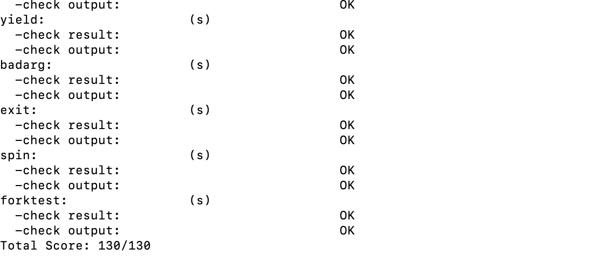
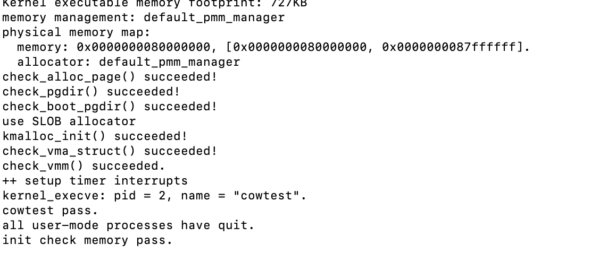

# 操作系统实验报告

## 实验基本信息

| 项目 | 内容 |
|---|---|
| **实验名称** | Lab5：用户程序 |
| **小组成员** | 2412896-石欣哲、2412105-贺佳怡、2412634-罗茜 |
| **完成日期** | 2026-11-26 |
| **当前状态** | 集成版 `1e619bc` 已构建并通过 130/130 评分、COW 自测和双 GDB 调试 |

### 小组分工

#### 练习与代码分工

| 成员 | 负责的练习/模块 |
|---|---|
| 2412896-石欣哲 | 进程启动、`alloc_proc/kernel_thread/init_main/user_main`、`exec/load_icode`、用户程序预加载说明 |
| 2412105-贺佳怡 | `do_fork`、`copy_mm/copy_range/dup_mmap`、普通进程复制、COW Challenge、COW 测试 |
| 2412634-罗茜 | trap 入口与返回、异常处理、系统调用分发、`do_wait/do_exit/do_yield/do_kill`、GDB 分支、最终集成 |

#### 报告分工

| 成员 | 报告内容 |
|---|---|
| 2412896-石欣哲 | 功能模块二、用户程序预加载问题、对应 spec/prompt 与问题记录 |
| 2412105-贺佳怡 | 功能模块三、COW Challenge、Dirty COW 分析、对应 spec/prompt 与问题记录 |
| 2412634-罗茜 | 总体逻辑、功能模块一、功能模块四、GDB 分支、接口约定、集成测试与统稿 |

---

## 一、实验目的

本实验的主要目的是：

1. 理解用户态程序如何通过 `ecall` 向内核发起系统调用，并理解 `sret` 如何返回用户态。
2. 掌握从第一个内核线程创建、ELF 程序装载到进入用户态的完整启动过程。
3. 理解 `fork`、`exec`、`wait`、`exit`、`yield`、`kill` 在进程生命周期中的协作关系。
4. 理解父子进程地址空间复制、进程树维护、僵尸进程回收和孤儿进程转移。
5. 通过 COW Challenge 理解页表写保护、缺页异常、页面引用计数和写时复制。
6. 使用 AI 工具辅助设计、实现和排查操作系统代码，并保留可复核的提示词与问题记录。

---

## 二、实验环境

### 2.1 开发与运行环境

| 成员 | 宿主系统 | 交叉编译器 | 模拟器 | 编辑器/运行方式 |
|---|---|---|---|---|
| 2412896-石欣哲 | WSL Ubuntu 24.04 | `riscv64-unknown-elf-gcc 15.1.0` | QEMU 4.1.1 | VS Code + WSL |
| 2412105-贺佳怡 | Windows + WSL2 Ubuntu | `riscv64-unknown-elf-gcc 13.2.0` | QEMU 4.1.1（验证）；8.2.2（兼容性检查） | VS Code + WSL |
| 2412634-罗茜 | Intel Mac + Docker Ubuntu 22.04.5 | `riscv64-unknown-elf-gcc 10.2.0` | QEMU 4.1.1 | VS Code + Docker |

最终集成和评分复现以罗茜环境为准：

- Docker 容器：`os`
- 容器内集成测试目录：`/tmp/lab5-integration-01a21730`
- GCC：`riscv64-unknown-elf-gcc 10.2.0`
- QEMU：4.1.1

### 2.2 AI 编程工具

| 成员 | AI 编程工具 | 底层模型 | 主要用途 |
|---|---|---|---|
| 2412896-石欣哲 | 材料未注明 | 材料未注明 | 启动链、ELF 装载及 GCC 15 兼容性 |
| 2412105-贺佳怡 | 材料未注明 | 材料未注明 | fork、COW 缺页和回滚测试 |
| 2412634-罗茜 | Codex | 原始实现阶段未注明 | 系统调用、进程控制、集成和双 GDB 调试 |

各轮 spec、提示词及 bug 记录见 [prompt.md](./prompt.md)。

---

## 三、实验整体逻辑分析

### 3.1 本章节的逻辑主线

Lab5 的主线是“让受保护的应用程序真正运行起来，并具备最基本的进程控制能力”。

在 Lab5 之前，系统中运行的主要是内核线程。Lab5 需要解决三个连续问题：

1. 用户程序不能直接访问内核资源，因此必须建立系统调用入口；
2. 系统启动时仍处于内核态，因此必须创建并装载第一个用户进程；
3. 用户进程运行后需要复制、退出、等待和终止，因此必须补齐进程生命周期。

这四个部分不是彼此独立的功能，而是一条完整链路：

```text
用户程序执行 ecall
    → trap 保存用户现场并进入内核
    → exception_handler 识别系统调用
    → syscall 分发到具体 sys_* 函数
    → do_* 完成进程或内存语义
    → 返回值写入 trapframe.a0
    → RESTORE_ALL + sret 返回用户态
```

### 3.2 功能的逐步实现

建议按照以下顺序理解本章：

1. **建立 trap 入口与返回机制**
   - 用户态进入内核时需要保存用户栈指针、通用寄存器、`sstatus`、`sepc`、`stval` 和 `scause`。
   - 返回用户态前需要恢复现场，并把下一次 trap 使用的内核栈顶写入 `sscratch`。

2. **实现系统调用分发**
   - 用户库将系统调用号放入 `a0`，参数依次放入 `a1` 至 `a5`。
   - 内核识别 `CAUSE_USER_ECALL`，将 `epc` 前移 4 字节，再调用 `syscall()`。
   - `syscall()` 通过调用号查表，并把结果写回用户可见的 `a0`。

3. **创建并装载第一个用户程序**
   - 内核线程 `init_main` 创建 `user_main`。
   - `user_main` 选择链接进内核镜像的用户程序。
   - `do_execve/load_icode` 解析 ELF、建立用户地址空间、映射代码和数据、创建用户栈、设置初始 trapframe。

4. **实现用户进程复制**
   - `do_fork` 构造子进程 PCB、内核栈和 trapframe。
   - `copy_mm/dup_mmap/copy_range` 复制或共享父进程地址空间。
   - 父进程返回子进程 pid，子进程从 0 返回。

5. **实现进程生命周期闭环**
   - `exit` 释放用户地址空间并转为僵尸进程。
   - `wait` 回收子进程内核栈和 PCB。
   - 父进程退出时，把自己的子进程转交给 `initproc`。
   - `yield` 请求重新调度，`kill` 设置目标进程退出请求。

6. **完成 COW 扩展**
   - 父进程 fork 后将可写页面设为只读并共享给子进程。
   - 任一方写共享页时触发 page fault，再复制页面并恢复写权限。

---

## 四、实验内容与实现

### 4.1 功能模块一：用户态系统调用

**负责人：** 2412634-罗茜

#### 模块功能描述

本模块负责完成用户态到内核态的系统调用控制流，包括：

- trap 现场保存与恢复
- 用户态 `ecall` 识别
- 系统调用号与参数读取
- 系统调用表分发
- 返回值写回
- 缺页异常向内存模块转发

**需要实现/修改的函数：**

```c
void interrupt_handler(struct trapframe *tf);
void exception_handler(struct trapframe *tf);
void syscall(void);

static int sys_exit(uint64_t arg[]);
static int sys_fork(uint64_t arg[]);
static int sys_wait(uint64_t arg[]);
static int sys_exec(uint64_t arg[]);
static int sys_yield(uint64_t arg[]);
static int sys_kill(uint64_t arg[]);
static int sys_getpid(uint64_t arg[]);
static int sys_putc(uint64_t arg[]);
static int sys_pgdir(uint64_t arg[]);
```

trap 入口汇编还完成了：

```asm
SAVE_ALL
mv a0, sp
jal trap

RESTORE_ALL
sret
```

#### 实现原理

用户程序通过 `ecall` 陷入内核。CPU 将特权级从 U 切换到 S，并把异常原因、异常地址和故障地址记录到相应 CSR。汇编入口负责：

1. 判断 trap 来自用户态还是内核态；
2. 用户态 trap 时切换到该进程内核栈；
3. 保存 31 个通用寄存器和 4 个控制状态；
4. 将 trapframe 地址传给 C 函数 `trap()`。

`exception_handler()` 对用户态 `ecall` 的处理为：

```c
tf->epc += 4;
syscall();
```

`ecall` 指令长度为 4 字节，如果不前移 `epc`，`sret` 后会再次执行同一指令，形成死循环。

`syscall()` 使用 `a0` 作为调用号，将 `a1` 起始的连续寄存器区域作为参数数组：

```c
uint64_t num = tf->gpr.a0;
ret = syscalls[num](&tf->gpr.a1);
tf->gpr.a0 = ret;
```

返回值必须写回当前进程的 `trapframe.gpr.a0`，因为 `sret` 后用户库直接从 `a0` 读取结果。

#### 系统调用对应关系

| 调用 | 内核动作 |
|---|---|
| `exit` | `do_exit(error_code)` |
| `fork` | 复制当前进程的 trapframe 和地址空间 |
| `wait` | `do_wait(pid, code_store)` |
| `exec` | `do_execve(name, len, binary, size)` |
| `yield` | 设置 `need_resched` |
| `kill` | 设置目标进程的 `PF_EXITING` |
| `getpid` | 返回 `current->pid` |
| `putc` | `cputchar(c)` |
| `pgdir` | `print_pgdir()` |

#### 缺页异常接口

缺页异常统一通过以下接口交给内存模块：

```c
int do_pgfault(struct mm_struct *mm, uint32_t error_code, uintptr_t addr);
```

罗茜负责从 `trapframe` 中取得 `tval`、访问类型和用户态标志；贺佳怡负责普通缺页和 COW 的实际处理。

错误码约定：

```c
#define PFAULT_PRESENT 0x1
#define PFAULT_WRITE   0x2
#define PFAULT_USER    0x4
```

#### 最终提示词

> 根据实现整理的提示词。迭代记录见 [prompt.md](./prompt.md)。

````markdown
在 RISC-V ucore Lab5 中实现用户态系统调用链路，要求：

1. 阅读 trapentry.S，实现 SAVE_ALL/RESTORE_ALL，使用 36 个 8 字节槽位保存通用寄存器和 sstatus、sepc、stval、scause。
2. 用户态 trap 时正确切换内核栈；返回用户态前把内核栈顶写入 sscratch。
3. __alltraps 将 sp 作为 trapframe 参数传入 trap()。
4. exception_handler 只对 CAUSE_USER_ECALL 将 epc 加 4，然后调用 syscall。
5. syscall 从 current->tf 读取 a0 作为系统调用号，以 a1..a5 作为参数，查表分发并把结果写回 a0。
6. 非法调用号返回 -E_INVAL，不允许越界访问函数表。
7. 缺页异常按 do_pgfault(mm, error_code, tval) 统一转发。
8. 所有新增代码保留 lab5 注释，并用 2412634 标注负责人。
````

#### 实现迭代过程

##### 第一次迭代

**实现内容：**

- 完成用户态/内核态双向 `RESTORE_ALL`
- 完成 `__alltraps` 参数传递
- 完成系统调用表与 `sys_*` 函数
- 完成缺页异常入口

**遇到的问题：**

1. 最初接口草案将 `do_wait()` 描述为成功时返回子进程 pid，但用户库 `wait()`、`waitpid()` 和评分测试实际期望成功返回 0，失败返回负错误码。
2. 项目仍包含其他成员负责的未实现函数，完整链接无法通过，不能把链接失败错误归因于 trap 或系统调用模块。

**问题解决策略：**

- 将 `do_wait()` 成功返回值修正为 0，并同步修改接口文档。
- 对 trap、syscall、proc 中的罗茜模块分别编译目标文件，区分“本模块编译错误”和“其他模块尚未实现”的链接错误。

##### 第二次迭代

**改进内容：**

- 给关键控制流补充中文注释，并在主要实现块标注 `2412634`。
- 明确缺页失败时用户进程应被终止，而不是让整个内核崩溃。
- 明确 `do_kill()` 只设置退出请求，实际资源回收仍由 `do_exit()` 完成。

**当前结果：**

- ✅ `kern/trap/trap.c` 编译通过
- ✅ `kern/trap/trapentry.S` 汇编通过
- ✅ `kern/syscall/syscall.c` 编译通过
- ✅ `kern/process/proc.c` 编译通过
- ✅ 集成版系统调用评分检查通过

---

### 4.2 功能模块二：创建并加载第一个用户进程

**负责人：** 2412896-石欣哲

#### 模块功能描述

本模块负责从内核线程过渡到第一个用户程序，主要包括：

```c
static struct proc_struct *alloc_proc(void);
int kernel_thread(int (*fn)(void *), void *arg, uint32_t clone_flags);
static int init_main(void *arg);
static int user_main(void *arg);
static int kernel_execve(const char *name,
                         unsigned char *binary,
                         size_t size);
int do_execve(const char *name, size_t len,
              unsigned char *binary, size_t size);
static int load_icode(unsigned char *binary, size_t size);
```

#### 实现链路

1. `proc_init()` 创建 `idleproc`；
2. `idleproc` 创建 `initproc`；
3. `init_main()` 创建 `user_main()` 所在内核线程；
4. `user_main()` 选择已经链接到内核镜像中的用户程序；
5. `kernel_execve()` 进入 `exec` 路径；
6. `do_execve()` 回收旧地址空间并调用 `load_icode()`；
7. `load_icode()` 解析 ELF，映射代码段、数据段、BSS 和用户栈；
8. 设置 `trapframe.epc`、`sp`、`sstatus`；
9. 通过 trap 返回路径第一次进入 U 态。

#### 核心实现与迭代

`alloc_proc` 初始化 PCB、上下文和进程关系字段。 `proc_init` 建立 idle 进程和 PID 哈希表，再用 `kernel_thread` 创建 init 线程。 `init_main` 启动 `user_main`，以 `do_wait(0, NULL) >= 0` 回收退出进程，检查空闲资源后结束实验。

`kernel_execve` 构造 trapframe 并复用 `__trapret`。 `do_execve` 切回内核页表并按引用计数释放旧地址空间。 `load_icode` 检查 ELF，映射段、清零 BSS、建立用户栈并设置 `epc`、`sp` 和 `SPP`。装载成功时增加新地址空间引用计数。

石欣哲修正了 `kernel_execve` 的前置声明、GCC 15 的 `kva2page` 指针转换，以及评分注入时的 `free_area` 链接声明冲突。最终提示词与四轮记录见 [prompt.md](./prompt.md)。集成版 `hello`、`testbss`、`exit` 通过。

---

### 4.3 功能模块三：复制用户进程

**负责人：** 2412105-贺佳怡

#### 模块功能描述

本模块负责实现普通 `fork` 和地址空间复制：

```c
int do_fork(uint32_t clone_flags,
            uintptr_t stack,
            struct trapframe *tf);
static int copy_mm(uint32_t clone_flags,
                   struct proc_struct *proc);
int dup_mmap(struct mm_struct *to, struct mm_struct *from);
int copy_range(pde_t *to, pde_t *from,
               uintptr_t start, uintptr_t end,
               bool share);
```

#### 实现流程

1. `do_fork()` 分配进程控制块；
2. 分配内核栈；
3. 复制父进程 trapframe；
4. 根据 clone 标志复制或共享地址空间；
5. 建立 PID、哈希表、进程树关系和调度上下文；
6. 父进程返回子进程 PID，子进程返回 0；
7. 将子进程置为可运行态。

#### 核心实现与迭代

`copy_thread` 把 trapframe 放到子进程内核栈顶，设置 `a0=0`、`context.ra=forkret` 和 `context.sp`。 `copy_mm` 对 `CLONE_VM` 增加共享 mm 引用，普通用户 fork 建立独立页表并用 `dup_mmap` 复制 VMA。集成版普通 fork 在页级采用 COW，`copy_range` 同时保留按页深复制路径。

迭代中修正了子进程首次调度的栈与返回上下文，以及 `satp` 需要页目录物理地址的问题。复制失败时先清理目标映射，再销毁未完成的 mm。 `badarg` 和 `forktest` 通过，具体提示词和回滚记录见 [prompt.md](./prompt.md)。

---

### 4.4 功能模块四：进程退出、等待、让出与终止

**负责人：** 2412634-罗茜

#### 模块功能描述

本模块完成进程生命周期的收尾逻辑：

```c
int do_wait(int pid, int *code_store);
int do_exit(int error_code);
int do_yield(void);
int do_kill(int pid);
```

#### `do_wait`

`do_wait` 的行为：

- `pid == 0`：等待任意子进程；
- `pid > 0`：等待指定子进程；
- `code_store` 非空时，先通过 `user_mem_check` 验证用户地址可写；
- 找到僵尸子进程后，写回退出码；
- 在关中断状态下从哈希表和进程树中摘除子进程；
- 释放子进程内核栈和 PCB；
- 成功返回 0；
- 没有符合条件的子进程时返回 `-E_BAD_PROC`；
- 有子进程但尚未退出时，父进程进入睡眠并调用 `schedule()`。

关键点：

1. 必须先检查退出码用户指针，避免进程被回收后才发现参数非法；
2. 僵尸子进程不能由自己释放内核栈和 PCB，只能由父进程回收；
3. 摘链和哈希表删除必须在关中断状态下完成。

#### `do_exit`

`do_exit` 的执行顺序：

1. 禁止 `idleproc` 和 `initproc` 主动退出；
2. 切回内核页表；
3. 减少 `mm_struct` 引用计数；
4. 最后一个使用者退出时销毁用户地址空间和页目录；
5. 设置 `PF_EXITING`、`PROC_ZOMBIE` 和退出码；
6. 若父进程正在等待子进程，则唤醒父进程；
7. 把自己的子进程转交给 `initproc`；
8. 调用调度器离开 CPU。

`do_exit()` 不返回。当前进程释放用户地址空间，但内核栈和 PCB 必须保留到父进程调用 `do_wait()` 时回收。

#### `do_yield`

```c
int do_yield(void)
{
    current->need_resched = 1;
    return 0;
}
```

`do_yield()` 只设置重新调度标志。实际上下文切换发生在 trap 返回路径中，由 `schedule()` 选择下一个可运行进程。

#### `do_kill`

`do_kill()` 不直接释放目标进程资源，而是：

1. 根据 pid 查找目标进程；
2. 拒绝空闲进程、初始化进程和僵尸进程；
3. 设置 `PF_EXITING`；
4. 目标正在睡眠或处于可中断等待时将其唤醒；
5. 目标下一次返回用户态前执行 `do_exit()`。

#### 最终提示词

> 根据实现整理的提示词。迭代记录见 [prompt.md](./prompt.md)。

````markdown
在 RISC-V ucore Lab5 中实现进程生命周期函数：

1. do_wait(pid, code_store)：pid=0 等待任意子进程，pid>0 等待指定直属子进程。
2. 写入用户退出码前必须调用 user_mem_check。
3. 只有僵尸子进程才能被回收；回收时关中断移除进程树和哈希表关系，再释放内核栈和 PCB。
4. do_exit：释放当前进程用户地址空间，保存退出码，转为 PROC_ZOMBIE，唤醒等待父进程，把自己的子进程转交给 initproc，最后调用 schedule。
5. do_yield：只设置 need_resched 并返回 0。
6. do_kill：设置目标 PF_EXITING；睡眠目标需要唤醒；不直接释放其资源。
7. 遵守接口约定，保留 lab5 注释并用 2412634 标记负责人。
````

#### 实现迭代记录

##### 第一次迭代

**遇到的问题：**

- 用户态 `wait()` 实际使用 pid 0 表示任意子进程；`waitpid(-1, ...)` 按非法 pid 返回错误。
- 非法退出码指针必须返回错误但保留僵尸子进程，方便用户程序稍后用合法地址再次等待。
- 退出进程不能直接把子进程留在已死亡父进程下，否则会形成无人回收的进程树。

**解决策略：**

- `do_wait()` 对代码中 `pid != 0` 与 `pid == 0` 两条路径分别处理。
- 在任何摘链操作前验证 `code_store`。
- `do_exit()` 将孤儿子进程转交给 `initproc`。

##### 第二次迭代

**改进内容：**

- 在 `do_exit()` 中先从当前页表切回内核页表，再释放用户页目录。
- 在等待和销毁地址空间时补充错误码及关中断说明。
- 增加中文注释明确僵尸进程、孤儿进程和睡眠唤醒的状态变化。

**当前结果：**

- ✅ 四个目标文件编译通过
- ✅ `exit`、`badarg`、`yield` 和 `spin` 的评分检查通过

---

### 4.5 练习：用户态/内核态双向返回

**负责人：** 2412634-罗茜

`RESTORE_ALL` 的关键逻辑：

1. 读取保存的 `sstatus` 和 `sepc`；
2. 通过 `SSTATUS_SPP` 判断返回前处于用户态还是内核态；
3. 返回用户态时，将当前 trapframe 之后的内核栈顶写入 `sscratch`；
4. 恢复 `sstatus` 和 `sepc`；
5. 恢复通用寄存器；
6. 最后恢复 `sp`；
7. 执行 `sret`。

如果先恢复 `sp`，后续寄存器恢复会失去 trapframe 基址；如果返回用户态时没有更新 `sscratch`，下一次 trap 将无法找到正确内核栈。

---

### 4.6 Challenge 1：Copy-on-Write

**负责人：** 2412105-贺佳怡

#### 当前状态

COW 实现已随 `7d667c1` 合入集成版。 `bcc1ddd` 补充了设计、提示词及故障注入记录。

#### 设计约束

```c
#define PTE_COW 0x100
```

- fork 时父子进程共享物理页；
- 共享可写页的 PTE 清除 `PTE_W` 并设置 `PTE_COW`；
- 任一进程写入触发 store page fault；
- `do_pgfault` 检查 PTE 是否带 `PTE_COW`；
- 若页面仍被多个进程引用，则分配新页、复制内容、更新页表并恢复写权限；
- 若只剩当前进程引用，则直接恢复写权限；
- 修改 PTE 后刷新对应 TLB；
- 中途失败必须回滚页面引用计数和已建立映射。

#### COW 页面状态

| 状态 | PTE 特征 | 说明 |
|---|---|---|
| 独占可写 | `V=1,W=1,COW=0` | 普通私有页面 |
| 共享只读 | `V=1,W=0,COW=1` | fork 后父子共享 |
| 复制中 | 原页只读，新页正在建立 | 只出现在缺页处理内部 |
| 复制完成 | 写入者为 `V=1,W=1,COW=0` | 原页引用递减，其他映射仍可保留 COW 标记 |
| 待回收 | 引用计数降为 0 | 可释放物理页 |

#### 状态转换与验证

```text
独占可写 → fork → 共享只读 COW
共享只读 COW → 写缺页且 ref > 1 → 写入者得到私有可写页，原页引用减一
共享只读 COW → 写缺页且 ref == 1 → 原地恢复为独占可写
有效映射 → 退出解除映射 → ref == 0 时释放物理页
```

`user/cowtest.c` 让父、子、孙进程在同一虚拟地址分别写入并验证彼此隔离。罗茜和贺佳怡均记录了 `cowtest pass.` 及 `init check memory pass.`。

贺佳怡在临时副本注入第三页映射失败，验证 `copy_range` 返回 `-E_NO_MEM`，父页权限和引用恢复到 `W=1,COW=0,ref=1`，目标无残留映射。关闭权限恢复的负对照失败。该测试覆盖指定故障场景，细节见 [prompt.md](./prompt.md)。

#### Dirty COW 分析

真实漏洞涉及 COW 状态变化后，写入路径仍信任此前的权限或页面归属判断。安全条件是写入前确认本次操作持有当前映射的私有可写页。映射或引用状态发生变化时重新校验，多核环境还需要同步页表更新与引用计数。贺佳怡给出了 ucore 的概念模拟分析。上面的故障注入验证的是 fork 回滚，Dirty COW 竞态本身未实测。

---

### 4.7 Challenge 2：用户程序何时被预先加载

**负责人：** 2412896-石欣哲

ucore Lab5 没有文件系统，因此用户程序不是运行时从磁盘目录读取，而是在构建阶段编译成 ELF，并通过二进制符号链接进内核镜像。

宏 `KERNEL_EXECVE(name)` 会引用：

```c
_binary_obj___user_name_out_start
_binary_obj___user_name_out_size
```

这两个符号表示用户 ELF 在内存中的起始地址和长度。系统启动并调用 `kernel_execve` 时，整个 ELF 镜像已经作为内核镜像的一部分存在于内存中。

实际加载分为两个层次：

1. **镜像预加载**：用户 ELF 在构建时被链接进内核镜像，因此启动时已在物理内存中；
2. **进程映像装载**：`load_icode` 解析 ELF 程序头，把代码段和数据段复制到新用户地址空间，建立 BSS 和用户栈，并设置用户态初始 trapframe。

与常见操作系统相比：

- Linux 通常从文件系统读取可执行文件，建立文件相关映射后按需加载；
- ucore Lab5 将用户程序静态嵌入内核，省去文件系统和文件页缓存的依赖；
- 原因是本实验聚焦进程与地址空间，而不是文件加载，静态嵌入能保证在文件系统实现前运行第一个用户程序。

最终实现见 `code/Makefile` 的用户 ELF 链接及内核镜像规则，以及 `code/kern/process/proc.c` 的 `KERNEL_EXECVE` 和 `load_icode`。 `hello` 和 `testbss` 分别验证启动和 BSS 行为。

---

### 4.8 分支任务：GDB 调试 `ecall` 与 `sret`

**负责人：** 2412634-罗茜

#### 调试目标

观察一次完整的用户态系统调用：

```text
U 态执行 ecall
    → CPU 进入 S 态并保存异常现场
    → __alltraps / trap / exception_handler / syscall
    → RESTORE_ALL
    → sret
    → 恢复 U 态执行
```

#### 调试步骤与实测

终端 A 用宿主 GDB 启动带调试符号的 QEMU 4.1.1。终端 B 连接 QEMU 的调试套接字，加载 `bin/kernel` 和 `obj/__user_exit.out`。QEMU 以 `-S` 等待 B 连接，A 在两个临时断点处分别执行一次 `continue`。

| 观察点 | 实测结果 |
|---|---|
| B 停在用户库 `ecall` | `pc=0x800104`，`a0=30`，`a1=0x49`，调用控制台输出字符 `I` |
| A 命中异常处理，B 到达 `__alltraps` | QEMU 的 `target/riscv/cpu_helper.c:504` 命中 `riscv_cpu_do_interrupt`。B 显示 `scause=8`、`sepc=0x800104` |
| B 停在 `sret`，A 命中返回辅助函数 | `sepc=0x800108`、`SPP=0`、`a0=0`。QEMU 的 `target/riscv/op_helper.c:75` 命中 `helper_sret` |
| 返回用户态与收尾 | B 的 `pc=0x800108`。A 输出 `exit pass.`、`init check memory pass.`，QEMU 正常退出 |


#### TCG 与调试问题

在 QEMU 4.1.1 的 `target/riscv/insn_trans/trans_privileged.inc.c`，`trans_ecall` 生成异常相关的 TCG 操作，`trans_sret` 生成调用 `helper_sret` 的操作。实际执行时，异常处理按委托设置特权级和陷阱 CSR，`sret` 根据 `SPP` 和 `sepc` 恢复特权级与 PC。Lab2 的页表实验也以 TCG 执行客户机指令为背景，观察点是访存引起的地址翻译与页表遍历。

调试中旧 QEMU 占用固定 TCP 端口，导致新会话连接超时或连接到旧会话。通过核对进程和端口定位后，使用新建的 Unix 套接字。客户机 GDB 单独加载用户 ELF 符号，宿主 GDB 预设两个临时断点。AI 协作记录见 [prompt.md](./prompt.md)。

---

## 五、测试与验证

### 5.1 完整构建与评分

集成版本为 `lab5-integration` 的 `1e619bc`。在罗茜的 `os` 容器中使用 GCC 10.2.0 + QEMU 4.1.1，从干净目录构建通过。 `make grade` 为 **130/130**。



### 5.2 用例覆盖

| 测试 | 结果 |
|---|---|
| `badsegment`、`divzero`、`softint`、`faultread`、`faultreadkernel` | 评分通过，覆盖用户异常路径 |
| `hello`、`testbss`、`pgdir` | 评分通过，覆盖启动、BSS 和页表查询 |
| `yield`、`badarg`、`exit`、`spin`、`forktest` | 评分通过，覆盖调度、参数检查、退出等待、终止和多进程回收 |
| `cowtest` | 独立运行通过，写入隔离及空闲页数检查通过 |
| 双 GDB | 用户态系统调用与返回的两个 QEMU 断点均命中，见 4.8 |



### 5.3 其他环境复测

| 成员与环境 | 实际结果 |
|---|---|
| 石欣哲，GCC 15.1.0 + QEMU 4.1.1 | 构建及 COW 自测通过，评分 116/130。材料记录 `divzero` 的 C 除零表达式受优化影响，两个非法读取用例偶发缺少评分所需的启动行，单独运行能打印该行 |
| 贺佳怡，GCC 13.2.0 + QEMU 4.1.1 | 构建、`badarg`、`forktest`、`cowtest` 及故障注入回滚验证通过。原版评分因本机 GDB 与旧 QEMU 调试协议问题未采集到日志。临时适配评分启动后为 123/130，`divzero` 失分 |
| 贺佳怡，QEMU 8.2.2 | 兼容性检查未得到内核启动输出。成员材料将差异记录为该环境的固件与实验所用 legacy SBI 不兼容 |

---

## 六、实验总结与收获

### 6.1 对操作系统的理解

| 知识点 | OS 原理含义 | 本实验对应 | 关系与差异 |
|---|---|---|---|
| 特权级与 trap | CPU 通过特权级隔离用户与内核 | U 态 `ecall` 进入 S 态，`sret` 返回 | 实验显式展示了硬件保存与软件恢复现场 |
| 系统调用 | 用户程序请求内核服务的受控接口 | `a0` 传调用号，`a1~a5` 传参数 | 实验机制简化，未涉及完整参数拷贝和信号机制 |
| PCB | 内核管理进程状态、上下文和资源 | `proc_struct` | 实验 PCB 含进程树、mm、trapframe 和调度字段 |
| 进程复制 | 创建与父进程共享代码和初始状态的新进程 | `do_fork/copy_mm/copy_range` | 实验为子进程建立独立页表，并按页采用 COW |
| 僵尸进程 | 已退出但尚未被父进程回收的进程 | `PROC_ZOMBIE` 与 `do_wait` | 实验明确展示了内核栈和 PCB 延迟回收 |
| 孤儿进程 | 父进程先退出而失去父进程的进程 | 转交 `initproc` | 实验用单一 init 进程完成托管 |
| COW | 共享只读页面，写时复制 | COW Challenge | 需要页表软件位、引用计数和缺页处理协同 |


### 6.2 AI 协作开发的经验

1. 先冻结接口，再让 AI 生成实现，能显著减少多人修改同一文件时的冲突。
2. AI 生成的代码不能直接视为正确，必须检查 `trapframe` 偏移、返回值约定和用户指针检查。
3. 编译单个目标文件可以把本模块错误与其他成员尚未实现的链接错误分开。
4. 报告应记录“已编译”“已运行”和“待验证”的区别，不能把对象文件编译通过写成系统测试通过。
5. 对 OS 代码而言，最有效的问题定位方式是结合寄存器、trapframe、页表状态和实际输出，而不是只根据自然语言描述猜测。
