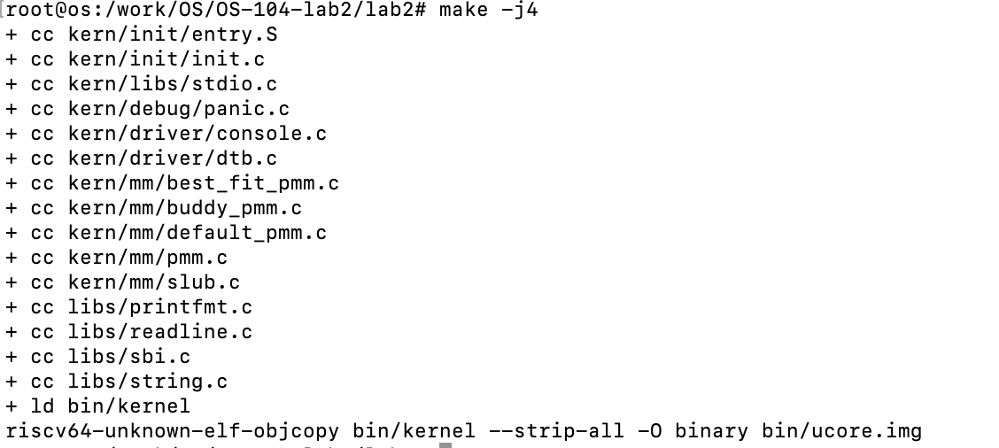
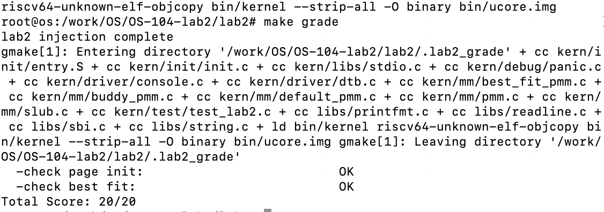
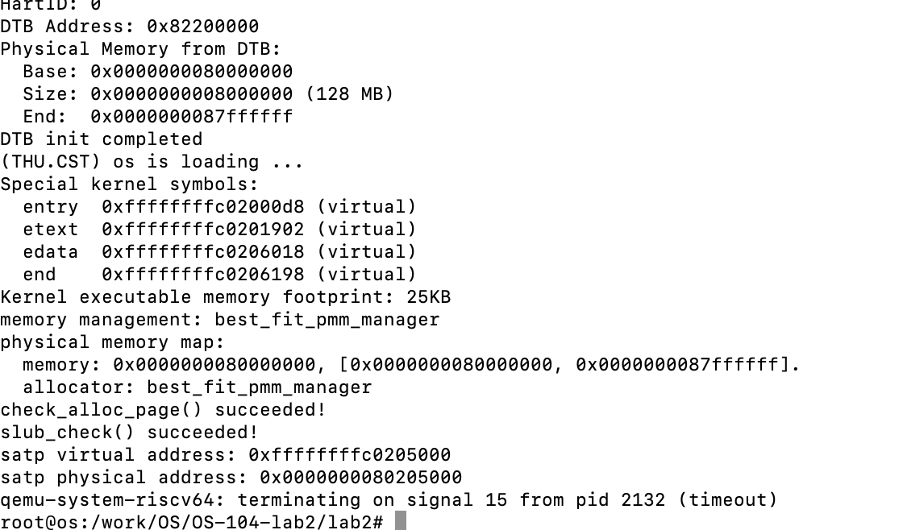
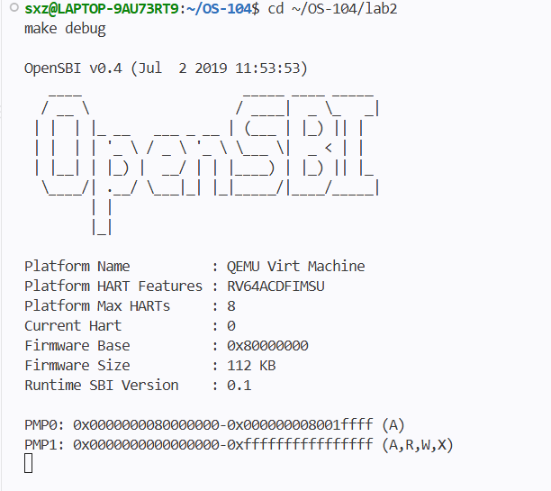
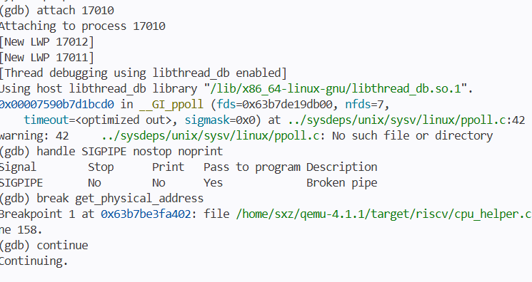
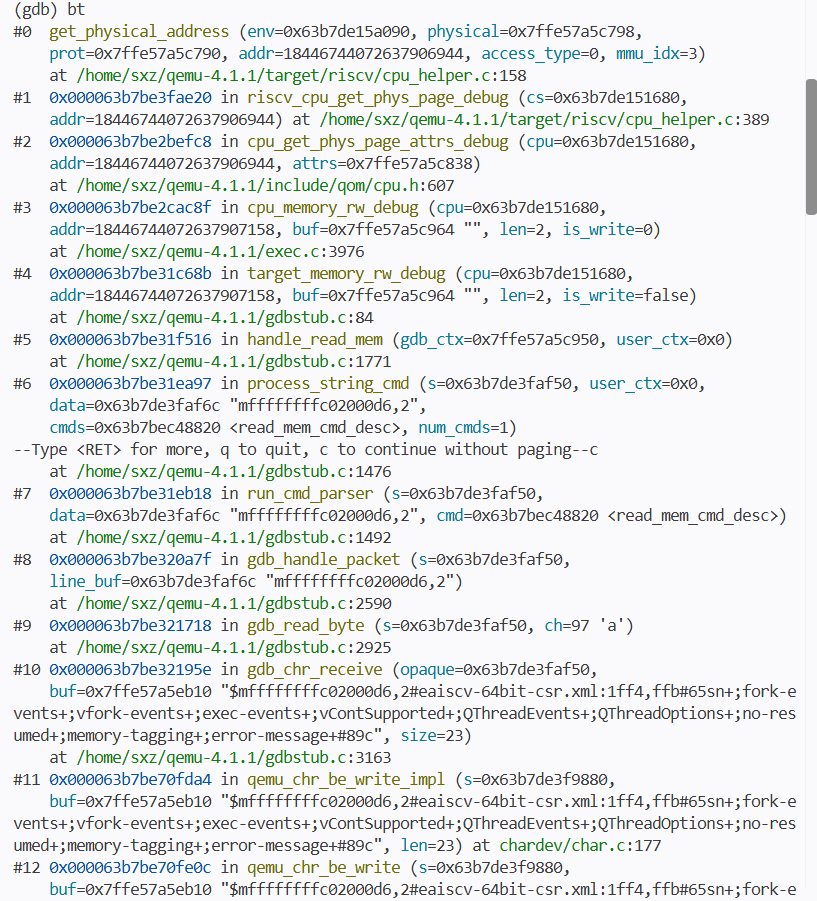
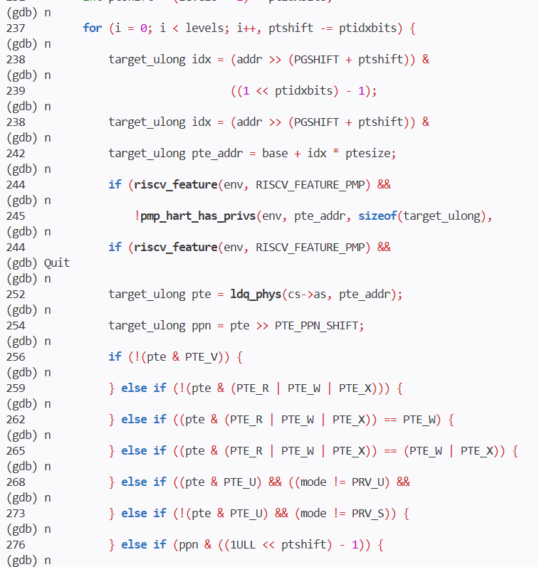
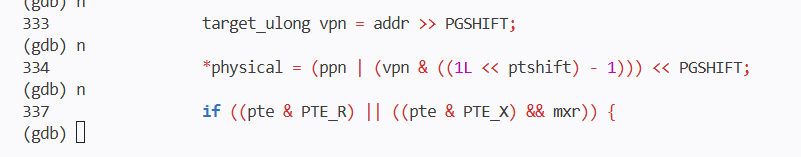

# 操作系统实验报告

## 实验基本信息

| 项目 | 内容 |
|---|---|
| **实验名称** | Lab 2：物理内存和页表 |
| **小组成员** | 2412896-石欣哲、2412105-贺佳怡、2412634-罗茜 |
| **完成日期** | 2026-10-20 |

### 小组分工

**练习分工**

| 成员 | 负责的练习/模块 |
|---|---|
| 2412896-石欣哲 | 物理内存探测与 `page_init()`、`pmm.c` 集成、GDB 页表调试 |
| 2412105-贺佳怡 | Best-Fit、SLUB |
| 2412634-罗茜 | First-Fit 分析、Buddy System、报告合并 |

**报告分工**

| 成员 | 负责的报告内容 |
|---|---|
| 2412896-石欣哲 | 整体逻辑、`page_init()`、GDB 调试 |
| 2412105-贺佳怡 | Best-Fit、SLUB |
| 2412634-罗茜 | First-Fit、Buddy、报告合并与格式检查 |

---

## 一、实验目的

1. 理解操作系统如何从设备树发现物理内存，并建立物理页管理结构。
2. 理解 First-Fit、Best-Fit 和 Buddy System 的页面分配、拆分与合并。
3. 理解 Sv39 页表、地址翻译和 TLB 的基本流程。
4. 学习使用 AI 辅助实现、测试和调试操作系统代码。

---

## 二、实验环境

| 成员 | 宿主系统 | 交叉编译器 | 模拟器 | 编辑器 |
|---|---|---|---|---|
| 2412896-石欣哲 | WSL Ubuntu 24.04 | riscv64-unknown-elf-gcc 13.2.0 | QEMU 4.1.1 | VS Code + WSL |
| 2412105-贺佳怡 | Windows + WSL2 Ubuntu | riscv64-unknown-elf-gcc 13.2.0 | QEMU 8.2.2 | VS Code + WSL |
| 2412634-罗茜 | Intel Mac + Docker Ubuntu 22.04.5 | riscv64-unknown-elf-gcc 10.2.0 | QEMU 4.1.1 | VS Code + Docker |

**AI 工具**

| 成员 | AI 编程工具 | 底层模型 |
|---|---|---|
| 2412896-石欣哲 | Cline（VS Code 插件） | DeepSeek-v4-flash |
| 2412105-贺佳怡 | Claude Code（VS Code 插件） | DeepSeek-V4-Pro |
| 2412634-罗茜 | Claude Code | DeepSeek-V4-Pro |

---

## 三、实验整体逻辑分析

Lab 2 围绕“发现内存、管理内存、分配内存、映射内存”展开：

```text
pmm_init()
  -> init_pmm_manager()
  -> page_init()
       -> 从 DTB 获取物理内存范围
       -> 建立 Page 描述符数组
       -> init_memmap()
  -> check_alloc_page()
  -> alloc_pages() / free_pages()
```

顺序不能颠倒：先通过 DTB 知道物理内存范围，才能确定 `Page` 数组大小；有了描述符和初始空闲区，分配器才能工作；页表则把这些物理页映射到内核虚拟地址。页表在 `entry.S` 中建立，`pmm_init()` 输出 `satp`，GDB 分支进一步观察 QEMU 的三级页表遍历。

---

## 四、实验内容与实现

### 4.1 物理内存探测与 `page_init()`

**负责人：** 2412896-石欣哲

**需要实现/修改的函数：**

```c
static void page_init(void);
void pmm_init(void);
```

`page_init()` 从 `get_memory_base()`、`get_memory_size()` 取得 DTB 范围，设置 `va_pa_offset`、`npage` 和 `pages`。`pages` 放在内核 `end` 之后并按页对齐；描述符数组覆盖 `[nbase, npage)`。所有描述符先标为 reserved，再从描述符数组末尾按页对齐的位置开始，把直到内存末尾的完整页面交给 `init_memmap()`。

**关键代码：**

```c
va_pa_offset = PHYSICAL_MEMORY_OFFSET;
npage = PPN(mem_base + mem_size);
pages = (struct Page *)ROUNDUP((uintptr_t)end, PGSIZE);
for (size_t i = 0; i < npage - nbase; i++) {
    pages[i].flags = pages[i].ref = pages[i].property = 0;
    SetPageReserved(&pages[i]);
}
uintptr_t free_start_pa = ROUNDUP(PADDR((uintptr_t)(pages + npage - nbase)), PGSIZE);
uintptr_t free_end_pa = ROUNDDOWN(mem_base + mem_size, PGSIZE);
if (free_start_pa < free_end_pa)
    init_memmap(pa2page(free_start_pa), (free_end_pa - free_start_pa) / PGSIZE);
```

**难点：** `end` 是虚拟地址，必须先设置 `va_pa_offset`，再用 `PADDR()` 把 `end` 和 `pages` 数组末尾转换成物理地址；描述符数组本身占用的页和内核尾页都不能进入空闲区。

**最终提示词：**

```text
阅读 ucore lab2 的 DTB、Page 描述符和 pmm_init 调用链，在 kern/mm/pmm.c 中实现 page_init()。
校验 DTB 范围；设置 va_pa_offset、npage、pages；pages 位于 end 之后并按页对齐；
所有描述符先 reserved；排除内核尾页和描述符数组；只把描述符数组之后的完整空闲页交给
init_memmap()；没有完整页时不要调用；输出物理内存范围。不要修改测试函数。
```

**迭代与问题：** 初版曾出现 `implicit declaration`，补上 `page_init()` 的前向声明后解决；后续通过 `[Test 1] Page Init` 验证。

**内存探测 Challenge：** 如果 OS 不能提前知道内存范围，可以由固件/引导程序提供内存描述，例如 UEFI `GetMemoryMap`、BIOS `E820`、设备树 `/memory/reg`、Multiboot memory map。本实验由 OpenSBI 把 DTB 地址放入 `a1`，内核解析 `/memory/reg`；没有可靠描述时，才考虑带异常保护的保守探测，不能直接盲目读写未知地址。

### 4.2 First-Fit 连续物理内存分配

**负责人：** 2412634-罗茜

First-Fit 使用按地址排序的空闲块链表，块头 `Page.property` 记录连续空闲页数，`PG_property` 标记块头。

- `default_init()`：初始化空链表，`nr_free = 0`。
- `default_init_memmap()`：清 flags/ref，把连续页设置为一个空闲块，并插入有序链表。
- `default_alloc_pages(n)`：从头找到第一个 `property >= n` 的块；摘除后，如果块更大，就在 `page + n` 处建立剩余块。
- `default_free_pages(base, n)`：把块插回有序链表，检查前驱和后继，能合并就合并。

**关键代码：**

```c
/* 分配：取第一个足够大的块，并在 page + n 处留下剩余块 */
if (p->property >= n) {
    page = p;
    break;
}
list_entry_t *prev = list_prev(&(page->page_link));
list_del(&(page->page_link));
if (page->property > n) {
    struct Page *p = page + n;
    p->property = page->property - n;
    SetPageProperty(p);
    list_add(prev, &(p->page_link));
}
nr_free -= n;
ClearPageProperty(page);

/* 释放：分别检查前驱和后继是否与 base 物理相邻 */
if (p + p->property == base) {
    p->property += base->property;
    ClearPageProperty(base);
    list_del(&(base->page_link));
    base = p;
}
if (base + base->property == p) {
    base->property += p->property;
    ClearPageProperty(p);
    list_del(&(p->page_link));
}
```

难点是释放合并：链表按地址有序时，只需看前后两个节点就能判断物理地址是否相邻；否则必须扫描整个链表。First-Fit 的优点是简单直观，缺点是每次分配从头扫描，可能切碎大块。改进方向包括 Best-Fit、按大小分桶、位图、Buddy、延迟合并等。

本题是思考题，没有代码生成 prompt；分析 spec 是“阅读 `default_pmm.c` 的四个核心函数，解释初始化、分配、释放、合并和改进空间”。

### 4.3 Best-Fit 连续物理内存分配

**负责人：** 2412105-贺佳怡

**需要实现/修改的函数：**

```c
static void best_fit_init(void);
static void best_fit_init_memmap(struct Page *base, size_t n);
static struct Page *best_fit_alloc_pages(size_t n);
static void best_fit_free_pages(struct Page *base, size_t n);
size_t best_fit_nr_free_pages(void);
static void best_fit_check(void);
```

Best-Fit 扫描所有空闲块，选择“容量不小于 n 且容量最小”的块；找到后拆分剩余部分，释放时按地址插回并合并相邻块。与 First-Fit 的“第一个足够大”不同，它优先保留大块，减少大块被小请求切碎的概率，但每次都要遍历整个空闲链表，时间开销更高，也更容易留下难以利用的小碎片。

**最终提示词：**

```text
参考 kern/mm/default_pmm.c，在 kern/mm/best_fit_pmm.c 中实现 Best-Fit：
扫描所有空闲块，选择 property >= n 且 property 最小的块；拆分剩余部分；
释放时按地址插回并合并相邻空闲块；维护 nr_free；定义 best_fit_pmm_manager。
不要修改 basic_check/best_fit_check 和框架测试。
```

**迭代与问题：**

1. 初版只保留了测试代码，没有导出 `best_fit_pmm_manager`，链接时报 `undefined reference`；补上 manager 结构体并让各函数指针指向实现后解决。
2. VS Code 曾因缺少宏定义头文件大量标红，补充 `#include <defs.h>` 后恢复。
3. 分配时若先 `list_del` 再使用原来的 `prev` 指针，链表插入位置会失效；改为先保存 `prev`，再删除并插入剩余块。

**改进空间：** 当空闲链表很长时，每次 O(n) 扫描开销较大。实际系统可用分离空闲链表、按大小分桶或树结构加速查找。

**测试结果：** `make grade` 输出 `[Test 2] Best-Fit: PASS`，总分 20/20。

### 4.4 Buddy System 伙伴系统

**负责人：** 2412634-罗茜

**需要实现/修改的函数：**

```c
static void buddy_init(void);
static void buddy_init_memmap(struct Page *base, size_t n);
static struct Page *buddy_alloc_pages(size_t n);
static void buddy_free_pages(struct Page *base, size_t n);
static size_t buddy_nr_free_pages(void);
static void buddy_check(void);
```

Buddy 把物理页按 `2^order` 组织成块，每个 order 维护一条空闲链表。分配时把请求向上取整到 2 的幂，找到最小可用 order 后逐层二分；释放时用页索引异或找伙伴，连续向上合并。

**关键代码：**

```c
/* 初始化：只选择地址对齐的 2 的幂块 */
while (order < MAX_ORDER) {
    size_t next_size = buddy_block_size(order + 1);
    if (next_size > remain || (index & (next_size - 1)) != 0)
        break;
    order++;
}

/* 分配：从大块向低 order 分裂，右半部分作为伙伴插回链表 */
for (int k = order - 1; k >= need_order; k--) {
    struct Page *buddy = block + buddy_block_size(k);
    buddy->flags = 0;
    buddy->property = 0;
    buddy_add_free_block(buddy, k);
}

/* 释放：用页索引异或找伙伴，连续向上合并 */
size_t buddy_index = buddy_page_index(base) ^ size;
struct Page *buddy = pages + buddy_index;
if (PageProperty(buddy) && buddy->property == size) {
    buddy_remove_free_block(buddy, order);
    buddy_remove_free_block(base, order);
    struct Page *merged = (base < buddy) ? base : buddy;
    size <<= 1;
    order++;
    merged->property = size;
    SetPageProperty(merged);
    buddy_free_area[order].nr_free += size;
    buddy_list_insert(order, merged);
    base = merged;
}
```

**难点：** 伙伴地址不能直接对 `struct Page *` 异或，而要先算页索引：

```text
buddy_index = (base - pages) ^ (1 << order)
```

块必须按自身大小对齐，否则异或结果不是真正的伙伴。非 2 的幂请求会占用向上取整后的块，因此存在内部碎片。

**最终提示词：**

```text
在 ucore lab2 中只新增 kern/mm/buddy_pmm.c/.h，不修改 pmm.c 和测试函数。
实现 order 空闲链表、按对齐的 2 的幂块初始化、向上取整分配、逐层分裂、
按页索引异或找伙伴并向上合并。用 Page.property 记录块大小，PG_property 标记空闲块头；
定义 buddy_pmm_manager，提供 buddy_check。要求 1/2/3/5/8 页分配和释放后计数恢复。
```

**迭代与问题：**

1. 第一版实现 order 链表、分裂和释放合并后，发现非 2 的幂释放需要记录实际分配块大小。
2. 第二版用 `Page.property` 保存分配块大小，并增加块对齐、边界和分配区间不重叠检查。
3. 最终主机侧压力/碎片测试、ASan/UBSan 和 QEMU 验证通过。

### 4.5 Challenge：任意大小内存对象分配（SLUB）

**负责人：** 2412105-贺佳怡

**需要实现/修改的函数：**

```c
void slub_init(void);
void *slub_alloc(size_t size);
void slub_free(void *ptr);
void slub_check(void);
```

SLUB 采用两层结构：第一层向 PMM 申请整页作为 slab，第二层按 size class（8、16、…、2048 字节）把 slab 切成固定大小对象，并用每个 cache 的空闲对象链表分配/释放。`slub_check()` 覆盖参数边界和对象复用。

**最终提示词：**

```text
模块生成：在 kern/mm/slub.c/.h 中实现简化的 SLUB：页级 slab + 按 8/16/.../2048
字节划分 size class；每个 cache 用空闲对象链表分配和释放；提供 slub_check。
测试生成：覆盖 0 字节、超大对象、不同 size class、释放复用和 slab 内对象分配。
不要修改 PMM 框架测试。
```

**迭代与问题：**

1. 一次 `git commit` 后发现 `slub.c` 为空，确认是 VS Code 未保存；重新粘贴并保存代码后提交。
2. 编译时找不到 `alloc_pages` 等函数，补充 `#include <pmm.h>` 和 `#include <defs.h>` 后解决。
3. 初版使用了不存在的 `page2kva`，改为 `page2pa(page) + va_pa_offset` 后编译通过。

**测试覆盖：**

- `slub_alloc(0) == NULL`，验证非法大小；
- `slub_alloc(4096) == NULL`，验证超过最大 size class 的对象被拒绝；
- 分配并释放 16 字节对象后再次申请，验证对象从 Free List 复用；
- 分配 32 字节对象，验证不同 size class 的空闲链表相互独立；
- 跨 slab 分配（一页对象用完后向 PMM 申请新 slab）作为扩展场景，当前代码已按 `slub_grow()` 设计，但未单独做压力测试。

**测试结果：** QEMU 启动后输出 `slub_check() succeeded!`。

### 4.6 分支任务：GDB 调试页表查询

**负责人：** 2412896-石欣哲

为观察 QEMU 的软件 MMU，石欣哲重新编译了带调试信息的 QEMU：

```bash
./configure --target-list=riscv64-softmmu --enable-debug
make -j$(nproc)
```

不执行 `make install`，只把 Makefile 的 `QEMU` 临时指向调试版。调试时使用三个终端：

```bash
# 终端1
make debug

# 终端2
pgrep -f qemu-system-riscv64
sudo gdb
(gdb) attach <PID>
(gdb) handle SIGPIPE nostop noprint
(gdb) break get_physical_address
(gdb) condition 1 mode == 1
(gdb) continue

# 终端3
make gdb
(gdb) b kern_init
(gdb) continue
```

终端 3 继续后，终端 2 停在 `get_physical_address`。调用链为 `gdbstub -> cpu_memory_rw_debug -> cpu_get_phys_page_attrs_debug -> riscv_cpu_get_phys_page_debug -> get_physical_address`，此时 `addr=0xffffffffc02000d6`（`kern_init` 附近）。

单步追踪 `target/riscv/cpu_helper.c` 时，关键步骤是：

1. 从 `satp` 取根页表物理页号，并读取分页模式；
2. Sv39 设置 `levels = 3`、每级 9 位索引、PTE 8 字节；
3. 循环提取 VPN[2]、VPN[1]、VPN[0]，计算 `pte_addr = base + idx * 8`；
4. `ldq_phys` 读取 PTE，检查 `PTE_V` 和 `R/W/X`；
5. 更新 A/D 位，最后用 PPN 加页内偏移拼出物理地址。

**难点：** `satp` 保存的是根页表的物理页号，不是虚拟地址；每一级 PTE 的 `R/W/X` 全为 0 时表示“指向下一级页表”，否则才是叶子页表项。TLB 未命中时才会进入 `get_physical_address`。真实 CPU 的 TLB 是硬件 SRAM，QEMU 用 `CPUTLBEntry` 等软件结构模拟，二者逻辑行为一致，物理实现不同。

**调试问题：** 新版 `riscv64-gdb` 连接 QEMU 4.1.1 时曾报 `vMustReplyEmpty: timeout`，改用旧版 GDB 后解决。

**GDB 任务提示词：** 在 QEMU 4.1.1 中只拦截 S 态的真实地址翻译，说明 `get_physical_address` 的关键分支、三级页表遍历、PTE 权限检查和最终物理地址拼装，并对比 QEMU 软件 TLB 与真实 CPU TLB。

**联调中修复的问题：** `page_init` 的 `implicit declaration` 通过补前向声明解决；Best-Fit 的 `list_del` 后失效指针通过保存 `prev` 节点解决；SLUB 的 `page2kva` 不存在，改为 `page2pa(page) + va_pa_offset`。

---

## 五、测试与验证

在 Docker `os` 容器中执行。最终结果：

### 官方评分

```bash
make grade
```

```text
-check page init:                          OK
-check best fit:                           OK
Total Score: 20/20
```

### 默认 Best-Fit 运行

```bash
timeout 15s make qemu
```

```text
memory management: best_fit_pmm_manager
check_alloc_page() succeeded!
slub_check() succeeded!
```

`timeout` 返回 124 是正常的，内核最后进入 `while (1)`。

### Buddy 运行

```bash
make clean
timeout 20s make DEFS=-DPMM_BUDDY qemu
```

```text
memory management: buddy_pmm_manager
Buddy: PASS
check_alloc_page() succeeded!
slub_check() succeeded!
```

### 测试截图：

**编译：**



**page_init 运行：**


**官方评分：**



**默认 Best-Fit：**



**Buddy：**


**GDB 终端一：**



**GDB 终端二：**



**GDB bt：**



**GDB for：**



**GDB physical：**



---

## 六、实验总结与收获

### 知识点与 OS 原理

| 本实验知识点 | OS 原理对应 | 关系与差异 |
|---|---|---|
| `Page` 描述符与 flags/ref/property | 物理页帧管理 | 实验用 `Page` 数组管理页框；真实 OS 还会加入锁、NUMA、迁移等 |
| First-Fit / Best-Fit | 连续内存分配、外部碎片 | 实验用双向链表和 `property` 合并；真实内核常用伙伴系统/slab |
| Buddy System | 2 的幂块分配、伙伴合并 | 实验实现 order 链表；真实 OS 还要处理并发和迁移 |
| SLUB | 内核对象缓存、slab | 实验是简化两层结构；Linux 还有 per-CPU cache、partial slab |
| Sv39 三级页表 | 虚拟内存、页表遍历、TLB | 实验观察 QEMU 软件模拟；真实 CPU 由硬件 MMU/TLB 完成 |

本实验未覆盖：进程/线程调度、上下文切换、多核并发与锁、缺页异常、页面置换、系统调用、文件系统、共享内存、写时复制、NUMA、大页和 TLB shootdown。

### AI 协作经验

先把 spec 写清楚，再让 AI 写代码。Buddy 的 prompt 必须说明 2 的幂块、地址对齐、`Page.property` 的含义和释放合并规则；否则容易生成“像 Buddy 但伙伴地址算错”的代码。主机侧最小桩测试适合快速定位算法错误，QEMU 负责验证真实内核集成。石欣哲的 GDB 调试还说明：遇到新版 GDB 与旧版 QEMU 协议不兼容时，记录完整报错并尝试匹配版本，比盲目改代码更有效。
